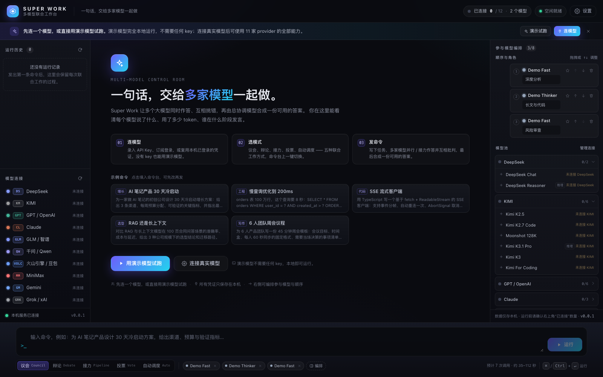
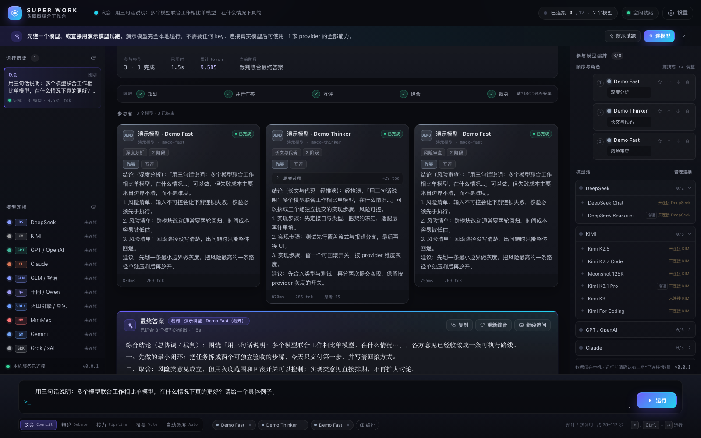
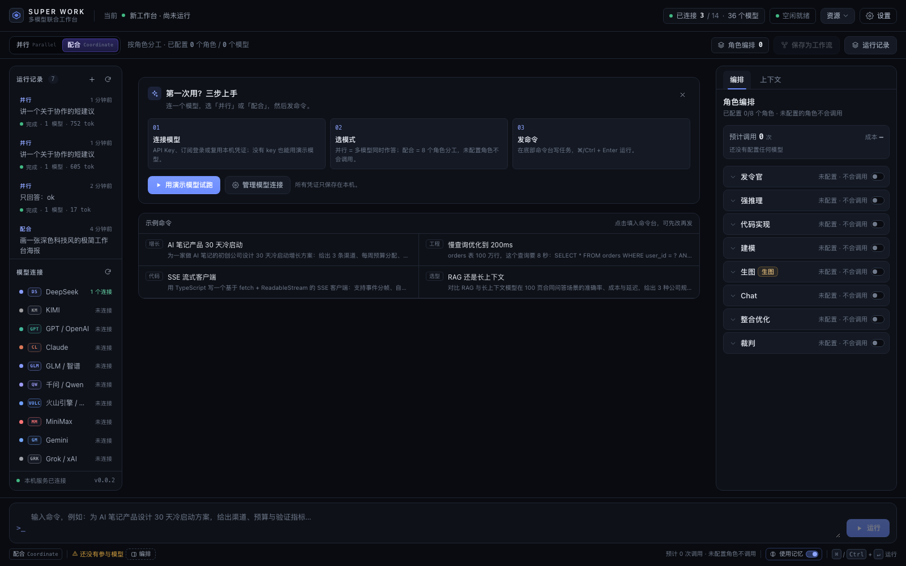
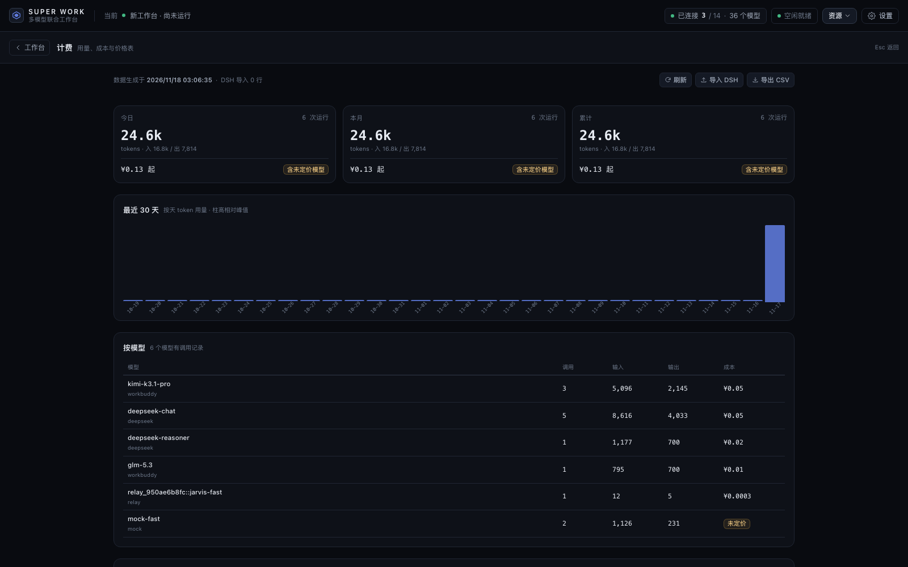
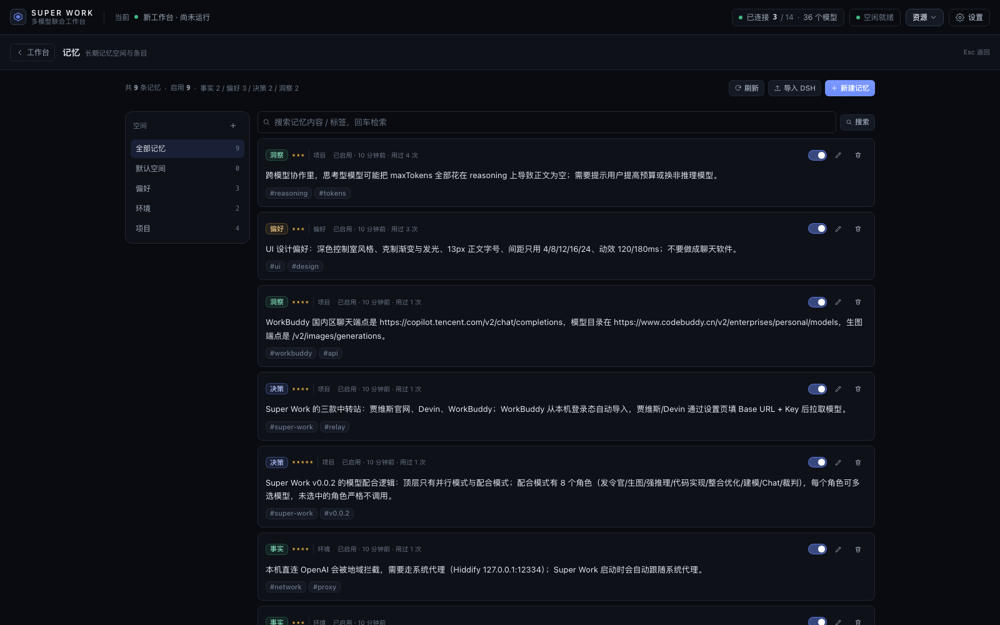
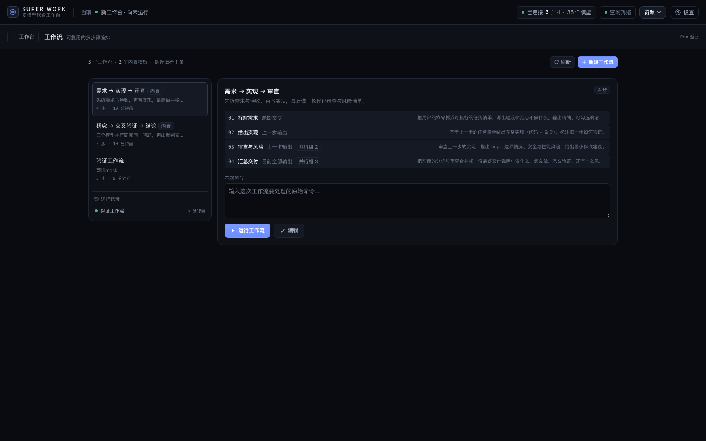
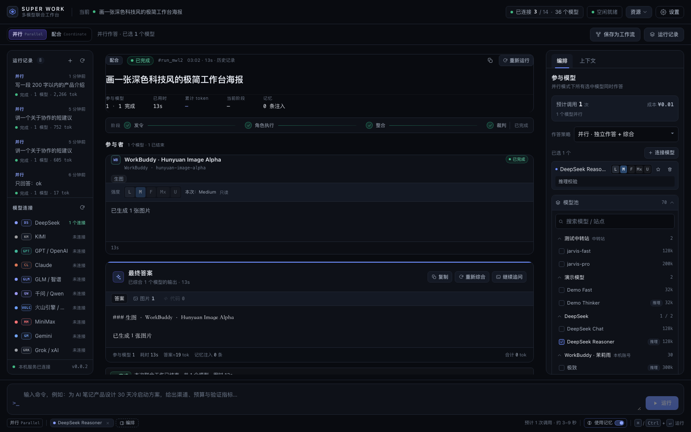
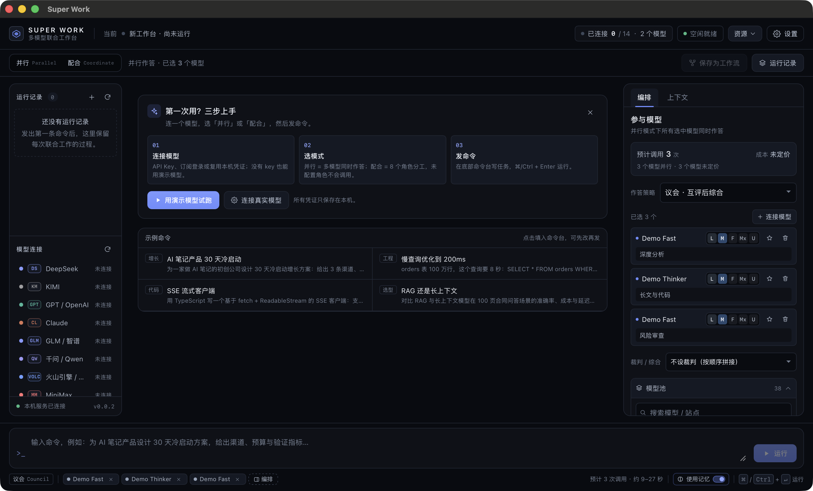

# Super Work

> 多模型联合工作台 · v0.0.3
>
> 一句命令，让 DeepSeek、KIMI、GPT、Claude、GLM、千问、火山方舟、MiniMax、Gemini、Grok 一起干活。

Super Work 是一个**跑在你自己电脑上的独立网站**：启动后浏览器打开 `http://127.0.0.1:7788`，
输入任务，选择参与的大模型与协作模式，看着它们在同一个画布里并行作答、互相批判，
最后由总协调模型把多方结论合成一份可用的最终答案。所有数据、凭证都留在本机。

[](https://github.com/zengpu987-ctrl/super-work/actions/workflows/ci.yml)
[](LICENSE)


[](paper/super-work-paper.pdf)

> **开源仓库**：https://github.com/zengpu987-ctrl/super-work · **文档站**：https://zengpu987-ctrl.github.io/super-work/ · **许可证**：Apache-2.0  
> **使用说明**：[docs/USER-GUIDE.md](docs/USER-GUIDE.md) · **DeepSeek 细节**：[docs/DEEPSEEK.md](docs/DEEPSEEK.md) · **DSH 账户 V4.1 Flash**：[docs/DEEPSEEK-ACCOUNT.md](docs/DEEPSEEK-ACCOUNT.md) · **OpenAI 直连**：[docs/OPENAI-DIRECT.md](docs/OPENAI-DIRECT.md)  
> **中英双语论文**：[paper/super-work-paper.pdf](paper/super-work-paper.pdf) · **评测报告**：[docs/SOFTWARE-EVALUATION.md](docs/SOFTWARE-EVALUATION.md)  
> **共建**：欢迎 Provider、文档排版、3D、安全、评测与翻译贡献，见 [CONTRIBUTING.md](CONTRIBUTING.md)、[ROADMAP.md](ROADMAP.md)、[COMMUNITY](docs/COMMUNITY.md)。

---

## 快速开始

```bash
cd super-work
pnpm install
pnpm dev          # 开发模式：服务端 7788 + 前端 5178（Vite 热更新）
```

打开 **http://127.0.0.1:5178** 即可使用。

macOS 也可以直接双击仓库根目录的 **`启动 Super Work.command`**：自动装依赖、编译、启动并打开浏览器。
想要**原生 Mac 应用**（Dock 图标 + 独立窗口，不弹终端/浏览器）：

```bash
bash apps/mac/build.sh          # 产物 apps/mac/build/Super Work.app
bash apps/mac/build.sh --open   # 构建并启动
```

详见 [apps/mac/README.md](apps/mac/README.md)。

生产模式（单端口，前端由服务端托管）：

```bash
pnpm build:all    # tsc -b + vite build
pnpm start        # http://127.0.0.1:7788
```

测试与验证记录见 [`docs/VERIFICATION.md`](docs/VERIFICATION.md)（构建、单元测试 65 项、端到端冒烟、
真实 DeepSeek / Kimi 调用、OAuth 与设备码启动、加密与持久化）。

第一次打开不需要任何 API key：内置**演示模型**，点"用演示模型试跑"就能看到完整的
议会式联合工作流程。之后在设置里连接真实模型即可。

---

## 界面

| 空状态（三步引导 + 示例命令） | 议会运行（阶段条 + 参与者阶段切换 + 最终答案） |
|---|---|
|  |  |

更多截图（v0.0.1）：[ChatGPT 订阅登录](docs/screenshots/03-chatgpt-subscription.png) ·
[KIMI 设备码登录](docs/screenshots/05-kimi-device-login.png) ·
[本机复用](docs/screenshots/06-local-reuse.png) ·
[API Key 与代理设置](docs/screenshots/04-settings-api-key.png)

v0.0.2（本版，界面由 Kimi K3.1 Pro 评审驱动）：

| 配合模式 8 角色 · 未配置不调用 | 计费面板 |
|---|---|
|  |  |

| 记忆系统 | 工作流 |
|---|---|
|  |  |

| 产物容器（答案 / 图片 / 代码） | 原生 Mac 应用 |
|---|---|
|  |  |

---

## v0.0.5 插件：全部适配、有效化

- **36 个 DSH 插件全部有可运行动作**：原生 9、真实桥接 12、原生适配 13、跳转 2，无「待迁移」。
- 真实动作：arXiv 检索、GitHub 只读（raw/API + token）、WorkBuddy 识图/OCR、生图、matplotlib 科研绘图、
  ffmpeg 检测、Wolfram/SymPy 计算、图片→MP4 视频、动效 HTML、日报 Markdown、Webhook 通知。
- 原生适配：主题市场 / 壁纸 / 阅读风格 / 入场动画 / Jarvis 悬浮球 / 工具栏设置。
- 插件中心「运行」按钮打开动作面板（字段 + 图片/视频/文件结果），测试仅对桥接命令可用。
- 全量清单与动作：[docs/PLUGINS.md](docs/PLUGINS.md)。

## v0.0.4 UI：透明玻璃 + 拨片开关

- 全界面改为**透明玻璃**：极光底 + 细网格 + 磨砂面板（顶栏/左右栏/命令台/答案卡/设置弹窗/团队抽屉），
  保留 Earth 3D 地球作为背景；`backdrop-filter` 不支持时自动回退不透明底。
- 所有开关统一为**拨片开关**（PaddleSwitch）：玻璃凹槽 + 金属拨片 + 防滑纹，位移用带过冲的弹簧曲线，
  按下压缩、切换光晕脉冲；支持键盘与 reduced-motion。
- 细节见 [`docs/UI-GLASS.md`](docs/UI-GLASS.md)。

## v0.0.3 新增

- **工作区实时光照 3D 地球**：NOAA 太阳位置驱动昼夜线，运行中缩到左上角自转，新建对话放大（详见 [`docs/SOFTWARE-EVALUATION.md`](docs/SOFTWARE-EVALUATION.md)）；
- **完整评测报告**：软件定位、功能评分、风险与路线建议（[`docs/SOFTWARE-EVALUATION.md`](docs/SOFTWARE-EVALUATION.md) / [DOCX](docs/Super-Work-Evaluation-Report.docx) / [PDF](docs/Super-Work-Evaluation-Report.pdf)）；


- **科技感 UI 重设计**：Kimi-K3.1-Pro 指挥舱规格（石墨金属 / 冷白信息 / 低饱和状态光 / 24px 网格 / 克制动效），
  完整设计见 [`docs/kimi-tech-ui-v3.md`](docs/kimi-tech-ui-v3.md)；
- **自定义角色**：配合模式除 8 个内置角色外可自建角色（名称/职责/是否生图/模型多选），与内置角色混排；
- **文件上传**：命令区支持图片 / PDF / Word / 代码，拖拽、⌘V 粘贴、本地解析提取正文，随运行计入上下文；
- **防 token 额外消耗**：每日成本/token 上限、单次运行与单次调用上限、80% 预警、超限拦截、高成本二次确认、省钱模式；
- **插件中心**：扫描 DSH 全部 35 个插件，标注已原生迁移 / 可桥接 / 仅 DSH，可测试桥接命令（如 ffmpeg）；
- **性能调控器**：并发 1–8、超时、默认输出 token、流式合并间隔；
- **关键词模块**：关键词 → 模式/角色/强度/记忆/省钱/裁判 的自动触发规则，支持测试与优先级；
- **答案输出规范化**：Markdown + KaTeX 公式 + 科学字体（STIX Two / Noto Serif SC / JetBrains Mono，离线打包）、
  代码块复制/下载、图片灯箱（下载/复制/新窗口）、文件卡片、视频/音频内嵌播放器，详见 [`docs/OUTPUT-STANDARD.md`](docs/OUTPUT-STANDARD.md)；
- **模型编队模块**：工具栏「模型团队」抽屉可直接增删成员、调强度、改角色、运行中单独停止某个模型；
- **贾维斯图标**：暗色几何反应核 + 三层断环，已替换 macOS App 图标并固定到程序坞。

## 能做什么

### 2 种协作方式（v0.0.2 主界面）

| 模式 | 过程 | 适合 |
|---|---|---|
| **并行 Parallel** | 选中的模型同时独立作答；可选裁判综合成一份结论 | 多视角比较、方案评审 |
| **配合 Coordinate** | 按 8 个角色分工：发令官下指令 → 强推理 / 代码实现 / 建模 / 生图 / Chat 执行 → 整合优化 → 裁判裁决 | 复杂任务、需要明确责任链 |

**配合模式的 8 个角色**（每个角色可多选模型，**未选中的角色严格不调用**）：
发令官、强推理、代码实现、建模、生图、Chat、整合优化、裁判。

### 每个模型 5 档强度（Low / Medium / Fast / Max / Ultra）

- 真实生效：映射到推理强度、maxTokens 倍率、温度，以及各平台原生参数（OpenAI `reasoning_effort`、
  Anthropic thinking budget、Gemini thinkingBudget、WorkBuddy 透传、mock 差异化输出）；
- **运行中也能改**：运行画布上直接切档，提示「下一次调用生效」，失败自动回滚；
- 历史运行会回显每个模型实际使用的档位。

旧版 5 种模式（议会 / 辩论 / 接力 / 投票 / 自动调度）仍可通过 API 使用，界面上收敛为以上 2 种。

### 三款中转站模型导入

| 中转站 | 接入方式 | 说明 |
|---|---|---|
| **WorkBuddy** | 自动读取本机登录态（国内 / 国际） | 上游目录 30+ 模型（Kimi-K3.1-Pro、GLM-5.3、DeepSeek-V4-Pro、Hunyuan Image…），按积分倍率计费，生图可用 |
| **贾维斯官网（我的贾维斯）** | 设置 → 中转站 → Base URL 已预填 `https://api.aijws.com/v1`，填 API Key | 自动 `GET /models`；本机 DSH 的 JWS/JWS1 Key 可复用，见 [docs/JARVIS.md](docs/JARVIS.md) |
| **Devin** | 同上 | 任意 OpenAI 兼容端点；也能接自定义 one-api / OpenRouter / 自建网关 |

导入后的模型会出现在模型池（按站点分组），可直接用于并行或配合模式。

### 模型目录随时同步

内置目录已更新至 **2026-11-18** 的当前版本（DeepSeek V4 Pro、Kimi K3.1 Pro、GPT-6.1 Terra/Sol、
Claude Opus/Sonnet 5.5、GLM-5.3、Qwen4-Max、Gemini 3.1 Pro、Grok 4.7、MiniMax M3、豆包 Seed-Evolving 等），
完整清单与来源见 [`docs/MODELS.md`](docs/MODELS.md)。

连接平台后，点顶部工具条的 **「同步模型」**（或 `POST /api/models/refresh`）即可从各家上游拉取最新目录，
合并进模型池（中转站 / WorkBuddy 也会一起刷新）。

### 15 家模型，三种凭证

> 所有模型连接的有效期统一显示为「长期有效」；底层 token 仍由本机凭证与上游刷新。
> 模型调用默认超时 300s，KIMI 慢模型保底 180s，避免长答案被 90s 截断。

| 平台 | API Key | 订阅账户 | 说明 |
|---|---|---|---|
| DeepSeek | ✅ | 本机复用 / 粘贴 | `deepseek-chat` / `deepseek-reasoner` |
| KIMI | ✅ | ✅ 官方设备码登录 | 会员额度走 `api.kimi.com/coding`（k3 / k3.1-pro） |
| GPT / OpenAI | ✅ | ✅ 官方 OAuth（ChatGPT） | 浏览器 PKCE 授权，走 Codex 后端 |
| Claude | ✅ | 粘贴 OAuth token | Anthropic 未开放第三方订阅授权 |
| GLM 智谱 | ✅ | 粘贴 | `glm-4.6` / `glm-4.6v` |
| 千问 Qwen | ✅ | 本机复用 / 粘贴 | DashScope 兼容模式 |
| 火山方舟 | ✅ | — | 模型名可填方舟接入点 `ep-xxx` |
| MiniMax | ✅ | — | `MiniMax-M2` 系列 |
| Gemini | ✅ | 粘贴 OAuth token | CLI 登录流在 v0.0.2 |
| Grok / xAI | ✅ | 粘贴 | `grok-4.1` |
| 第三方 / 自建 | ✅ | — | OpenRouter、硅基流动、Ollama、one-api… |

订阅账户有三种接法（设置 → 选平台）：

1. **订阅登录**：ChatGPT 弹浏览器授权；KIMI 显示设备码，在浏览器确认即可；
2. **本机复用**：自动发现本机 DSH 里已登录的 ChatGPT / Kimi 会员与 API key，一键导入（只读，不改原文件）；
3. **粘贴凭证**：把浏览器里拿到的 Bearer token / cookie 粘贴进来，适配任何平台或自建端点。

### 四个内建系统（从 DSH 能力导入并原生化）

| 系统 | 能力 |
|---|---|
| **计费** | 单价表（可编辑）→ 每次运行成本、今日/本月/累计、按模型明细、30 天柱状、CSV 导出；支持导入 DSH TokenLedger 历史账本 |
| **上下文洞察** | 每次模型调用的上下文组成（system / 命令 / 记忆 / 参考 / 历史）token 堆叠条、窗口占用百分比、最紧模型提示 |
| **记忆** | 记忆空间 + 条目（事实/偏好/决策/洞察）、中文搜索、启停、按命令召回并注入配合/并行运行、显示注入了几条；支持导入 DSH 记忆种子 |
| **工作流** | 可保存的多步骤编排：角色/模型/指令/输入来源/并行组；内置两个模板；运行结果可回看，运行可保存为工作流 |

### 工作台本身

- **流式运行画布**：每个参与者一张卡，实时打字、思考过程折叠、耗时与 token 统计；
- **阶段条**：清楚显示当前进行到"并行作答 / 互评 / 综合 / 裁决"哪一步；
- **参与编排**：右栏增删模型、调整顺序、改角色描述；模式说明与预计调用量实时提示；
- **运行历史**：每次运行可回看、复制最终答案、一键重跑；
- **离线优先**：无外部 CDN/字体/图片，断网也能打开（除模型调用本身）。

---

## 架构

```
浏览器 (React 19 + Vite)  ──HTTP/SSE──▶  本机服务端 (Fastify 5, 127.0.0.1:7788)
                                            │
                    ┌───────────────────────┼────────────────────────┐
                    ▼                       ▼                        ▼
            packages/orchestrator   packages/providers        node:sqlite 存储
            (8 种协作模式)          (15 家适配器)             凭证 AES-256-GCM 加密
```

- `packages/core`：唯一契约（类型、模型目录、事件、DTO）。
- `packages/providers`：OpenAI 兼容 / Anthropic / Gemini / ChatGPT 订阅 / Kimi 会员 / mock 适配器，统一流式接口。
- `packages/orchestrator`：模式编排，负责阶段、并发、互评、综合、容错与超时。
- `apps/server`：HTTP/SSE、凭证保险箱、OAuth 与设备码流程、运行持久化、本机凭证复用。
- `apps/web`：控制室 UI。

目录详见 [`docs/DESIGN.md`](docs/DESIGN.md)。

---

## 数据与安全

- 数据目录：`~/.super-work/`（`config.json`、`super-work.db`、`secret.key`）；
- 凭证使用 **AES-256-GCM** 加密后入库，密钥仅存本机（`secret.key`，权限 600）；
- 服务端只监听 `127.0.0.1`，不对外暴露端口；无遥测、无云端同步；
- "本机复用"只读取 `~/.dsh/.credentials.yaml`，绝不修改；可在设置里一键关闭；
- OAuth 令牌自动刷新（ChatGPT / Kimi），刷新失败会提示重新登录。

> 提醒：粘贴的网页会话 token 等同于账号访问权限，请只在自己的机器上使用。

---

## 开源、论文与共建

- **许可证**：Apache-2.0；第三方组件与素材见 [THIRD-PARTY-NOTICES.md](THIRD-PARTY-NOTICES.md)。
- **论文**：中英双语 12 页，[PDF](paper/super-work-paper.pdf) / [源文](paper/super-work-paper.md)。
- **模型健康**：[2026-11-21 全模型逐项自检](docs/MODEL-HEALTH-2026-11-21.md)（修复后 60/60 文本模型通过；14 个不可用项已下架/禁用；2 图片模型未测；29 未连接）。
- **使用说明**：[全功能手册](docs/USER-GUIDE.md)；**评测报告**：[SOFTWARE-EVALUATION.md](docs/SOFTWARE-EVALUATION.md)。
- **DeepSeek**：[接入、参数、计费与开发工作细节](docs/DEEPSEEK.md)。
- **如何参与**：fork + PR（文档可在 GitHub 网页直接改）；讨论区、Wiki、Codespaces 与维护者路径见 [docs/COMMUNITY.md](docs/COMMUNITY.md)。
- **我们要实现的目标**：厂商中立的多模型编排协议、本地优先的隐私标准、通用产物交付、可解释成本，以及开放插件/评测生态（详见 [ROADMAP.md](ROADMAP.md)）。

## DeepSeek 集成摘要

| 模型 | 上下文 | 最大输出 | 推理 |
|---|---:|---:|---|
| `deepseek-v4-pro` | 1,000,000 | 128,000 | ✅ |
| `deepseek-v4.1-flash` | 1,000,000 | 384,000 | ✅ |
| `deepseek-flash` | 1,000,000 | 128,000 | ✅ |
| `deepseek-v3.2` | 131,072 | 目录默认 | — |

统一走 OpenAI 兼容流式接口；五档强度映射 `max_tokens`/温度/提示词；凭证支持 API Key、本机 DSH 复用与 token；计费按本地单价表估算。完整说明（含本项目如何用 DeepSeek Harness 构建、验证与协作点）见 [docs/DEEPSEEK.md](docs/DEEPSEEK.md)。

## 引用

```bibtex
@misc{superwork2026,
  title  = {Super Work: A Local-First Multi-Model Orchestration Workbench},
  author = {{Super Work Contributors}},
  year   = {2026},
  note   = {Open-source software, Apache-2.0},
  url    = {https://github.com/zengpu987-ctrl/super-work}
}
```

## 代理（中国大陆网络必读）

本机直连 OpenAI 会被地域拦截。Super Work 启动时会自动读取 macOS 系统代理
（`scutil --proxy`）并接管 `fetch`；也可以在设置里手动填写，例如：

```
http://127.0.0.1:12334
```

设置页有"检测系统代理"按钮。代理改动立即生效，无需重启。

---

## 开发

```bash
pnpm build        # tsc -b（core → providers/orchestrator/memory/workflow → server）
pnpm build:web    # 前端产物 apps/web/dist（含离线 three.js 预置）
pnpm test         # 各包单元测试（191 项）
pnpm smoke        # v0.0.1 冒烟：隔离实例 + 演示模型跑一次议会
pnpm smoke:v2     # v0.0.2 冒烟：中转站预设/强度/并行/配合严格性/记忆/工作流/计费
pnpm build:mac    # 构建 apps/mac/build/Super Work.app
```

技术栈：Node ≥ 22（本机 24）、TypeScript strict、ESM、Fastify 5、React 19、Vite 7、
`node:sqlite`（零原生依赖）。

---

## v0.0.2 边界

已实现：并行/配合两种模式、8 角色分工、5 档强度（运行中可调）、15 家 + 3 款中转站、
中转站自助导入、计费/上下文/记忆/工作流四个系统、生图与 3D 代码产物、原生 Mac 应用、
191 个单元测试 + 三套端到端冒烟。

尚未实现：多用户与云端部署、工具调用（联网/表格）、对话式多轮上下文、文件输入、
Gemini/Claude 官方 CLI 登录流、WorkBuddy token 自动刷新（过期需重新导入）、
打包自带 Node 运行时（Mac 应用依赖本机 Node 22+）。
