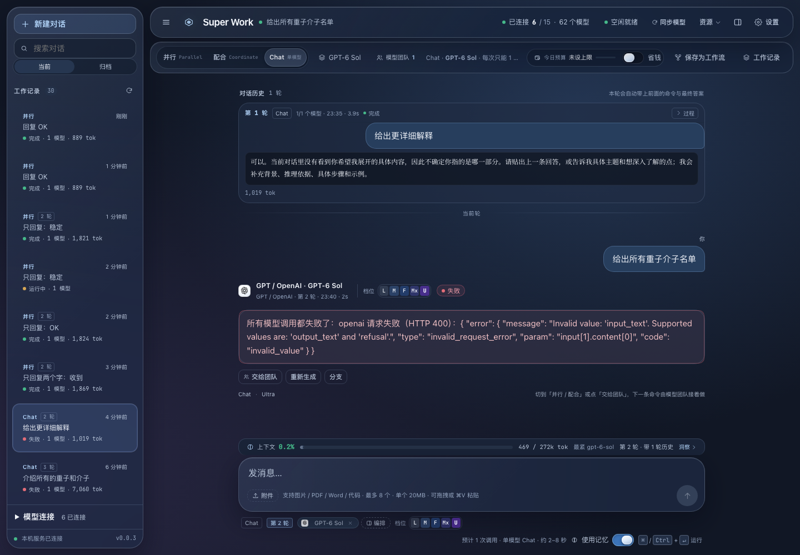
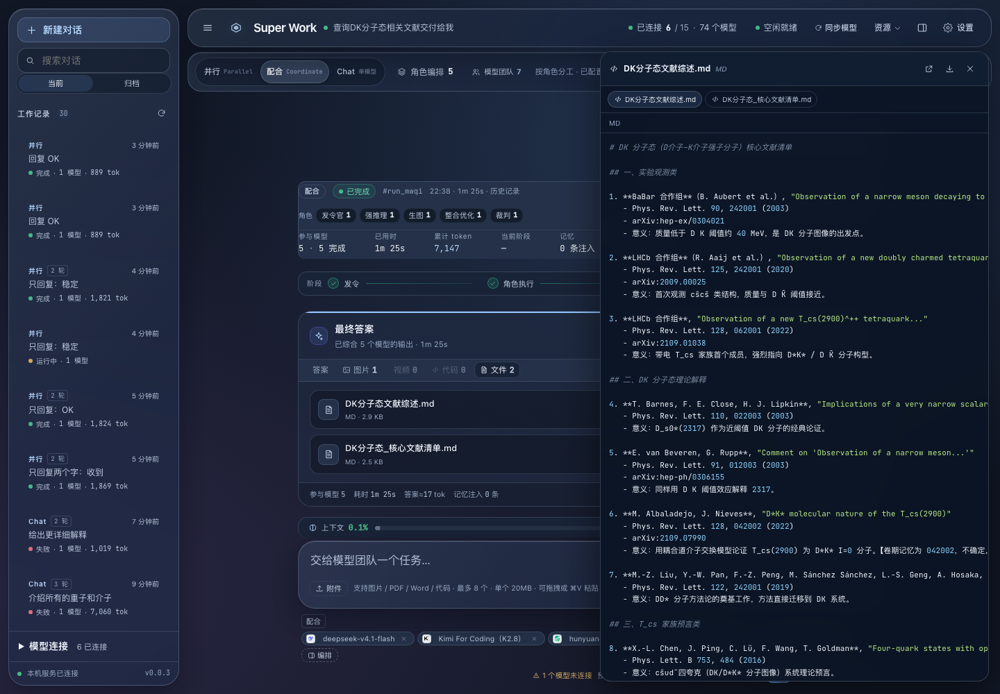

# 对话、分支、记忆与文件预览

> 本页说明 2026-11-21 新增的对话能力：同对话交给团队 / 重新生成、分支、对话记忆、归档/删除，以及右侧文件预览窗口。

## 1. 交给团队与重新生成：留在同一对话

### 交给团队

ChatView 和运行画布下方都有「交给团队」。现在它不是只切换模式，而是**立即在当前对话中发起一轮团队运行**：

- 沿用当前 `threadId`，轮次 +1；
- 前面几轮 Chat 历史会自动带入团队上下文；
- 默认并行；右栏「配合」入口可发配合团队；
- 成功后历史列表仍只有一条对话，不会新建工作。

### 重新生成

「重新生成」使用当前轮次的原命令与参与模型，在**同一 `threadId`** 中追加下一轮，不再创建新对话。  
`resynthesize`（重新综合）同样留在当前对话。

## 2. 对话分支

在 Chat 每轮操作区或运行画布点「分支」：

- 服务端从该轮往前复制完整运行（含结果、usage、产物文件与新产物路径）到新工作；
- 新对话带 `parentThreadId` / `branchedFromRunId` 元数据，历史列表显示「分支」标记；
- 原对话后续的轮次不会影响分支；分支可独立继续、归档或删除。

API：`POST /api/threads/:id/branch`，body `{ "fromRunId": "run_..." }`。

## 3. 对话记忆

每条对话可以保存一段**长期记忆**：

1. 在左侧历史条目悬停 → 点大脑图标；
2. 输入偏好、项目代号、已确认方案等；
3. 保存后只注入该对话的下一轮，不污染其他对话；
4. 记忆会作为 `【本对话记忆】` 追加到服务端 `memoryContext`。

API：`PUT /api/threads/:id/memory`，body `{ "memory": "..." }`。  
记忆字段随分支复制；归档/删除对话不会删除记忆内容（软删除）。

## 4. 归档与删除对话

历史条目悬停时显示三个操作：

| 按钮 | 行为 |
|---|---|
| 大脑 | 编辑对话记忆 |
| 时钟 | 归档 / 取消归档 |
| 垃圾桶 | 删除（二次确认） |

- 顶部「当前 / 归档」切换归档视图；
- 归档：默认历史隐藏，归档视图可见，可取消；
- 删除：软删除，历史隐藏；运行、事件、产物文件仍保留在本机，避免误删文件引用。

API：
- `POST /api/threads/:id/archive`，body `{ "archived": true }`
- `DELETE /api/threads/:id`
- `GET /api/threads?archived=1`

## 5. 右侧文件预览

- 新文件产物交付时，右侧自动打开预览窗口；也可在文件列表点「预览」再次打开；
- **PDF**：直接在当前窗口的 iframe 中显示（浏览器 PDF 阅读器），可新窗口 / 下载；
- **图片 / 视频 / 音频**：直接内嵌；
- **代码 / Markdown / 文本**：按扩展名做轻量语法高亮，显示行数、代码行号样式与等宽字体；
- **HTML**：沙箱 iframe 可视化运行；
- 其他 Office 文件：有文本则显示文本，否则提供新窗口 / 下载；
- 预览窗口固定在右侧（`position: fixed`，portal 到 `document.body`），不挤压对话主列；移动端自适应全宽。

实现：`apps/web/src/components/ArtifactPreviewPanel.tsx`、`FileArtifacts.tsx`。

## 6. 验证

- `pnpm test`：**194 项全绿**（新增 thread_meta / copyRunRow 测试）；
- 实测：
  - 同对话交给团队：Chat 2 轮 → 团队并行第 3 轮，`threadId` 不变；
  - 重新生成：mock Chat 从 1 轮变 2 轮，仍是一条对话；
  - 分支：复制截至该轮的运行与产物路径；
  - 记忆：保存后下一轮 `memoryContext` 包含 `【本对话记忆】`；
  - 归档/删除：当前列表隐藏、归档视图可见、删除后隐藏；
  - 文件预览：Markdown 代码高亮、右侧面板打开；PDF 走同一 iframe 分支。

## 7. 边界

- 分支复制的是运行结果与产物，不复制逐 token 事件流（历史详情不依赖事件流）；
- 删除为软删除，磁盘数据不会立即擦除；清理磁盘需单独做本地维护；
- PDF 直接展示依赖浏览器内置 PDF 阅读器；不支持时会退化为下载；
- 文件预览的语法高亮是轻量实现（无额外依赖），不追求完整语言服务级着色。
