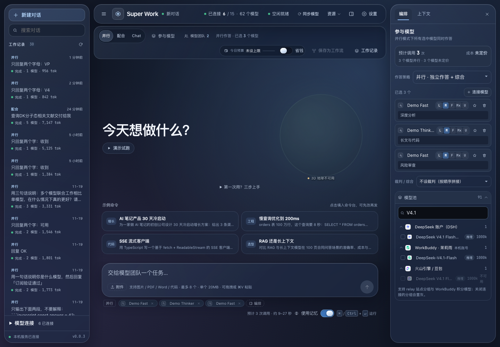

# DeepSeek 账户（DSH）通道：V4.1 Flash

> 新增的 `deepseek-account` 通道，用 **DSH 的 DeepSeek Account 登录态**访问 V4.1 Flash。
> 它与原有的 `deepseek`（API Key）通道相互独立；不把账号 token 当 API Key 用。



## 1. 为什么单独做一条通道

| 通道 | 凭证 | 端点 | 模型目录 |
|---|---|---|---|
| `deepseek`（原有） | API Key | `https://api.deepseek.com/v1`（OpenAI 兼容） | 当前 Key 只返回 `deepseek-flash` / `deepseek-v4-pro` |
| `deepseek-account`（新增） | DSH Account token | `https://api.deepseek.com/anthropic/v1`（Anthropic Messages） | `deepseek-flash`（即 V4.1 Flash）、`deepseek-v4-pro` |

DSH 的账户通道不是 OpenAI 兼容协议，而是 **Anthropic Messages**：
`POST /messages`，用 `x-dsh-auth-token` 鉴权，使用 `anthropic-version: 2023-06-01`。
因此没有把它硬塞进现有 API Key 适配器，而是新增 `DeepSeekAccountAdapter`。

## 2. 模型 ID 对照

| 模型 | provider | model ID |
|---|---|---|
| DeepSeek V4.1 Flash（DSH 账户） | `deepseek-account` | `deepseek-flash` |
| DeepSeek V4 Pro（DSH 账户） | `deepseek-account` | `deepseek-v4-pro` |

> **V4.1 Flash 在 DSH 目录里的 ID 是 `deepseek-flash`**，不是 `deepseek-v4.1-flash`。  
> 旧的 DeepSeek API Key 通道里也有 `deepseek-flash`，两条通道靠 provider 区分；在模型池里会显示为「DeepSeek 账户（DSH） · DeepSeek V4.1 Flash（DSH 账户）」。

## 3. 如何接入

### 自动（本机已登录 DSH）

1. 确认 DSH 已登录 DeepSeek Account；
2. 打开 Super Work → **设置 → 模型连接 → DeepSeek 账户（DSH）**；
3. 在「本机登录」中导入 **DeepSeek V4.1 Flash（DSH 账户）**；
4. 模型池出现「DeepSeek 账户（DSH）」分组，选中即可用于并行 / 配合 / Chat。

凭证从 `~/.dsh/.credentials.yaml` 的以下记录读取：

```yaml
records:
  deepseek-account-platform/default:
    payload:
      token: <DSH Account token>
```

Super Work 只在导入时读取并把 token 存进本地加密凭据库；**不会上传、不会写进仓库、不会回退到 API Key**。

### 手动（粘贴 token）

如果本机没有 DSH 凭证，可在该 provider 的「Token」模式粘贴 DSH Account token；
适配器会把它放进 `x-dsh-auth-token`，而不是 `Authorization: Bearer`。

## 4. 实现位置

| 层 | 文件 | 内容 |
|---|---|---|
| 核心类型/目录 | `packages/core/src/types.ts`、`packages/core/src/catalog.ts` | `deepseek-account` provider + V4.1 Flash / V4 Pro 目录 |
| 适配器 | `packages/providers/src/deepseek-account.ts` | Anthropic Messages 请求、`x-dsh-auth-token`、SSE 解析 |
| 适配器路由 | `packages/providers/src/index.ts` | `createAdapter` / `adapterForCall` 分支 |
| 本机凭证 | `apps/server/src/local-reuse.ts` | 从 DSH 记录发现 `dsh:deepseek-account` |
| UI 品牌图标 | `apps/web/src/lib/brandIcons.ts` | 复用 DeepSeek 图标 |

适配器复用现有 `buildAnthropicBody` / `streamAnthropicResponse`，所以 thinking、usage、system 独立字段、SSE 错误映射与 Anthropic 适配器一致。

## 5. 实测记录

- 2026-11-21 23:06：`deepseek-account` / `deepseek-flash` 运行「只回复两个字母：V4」→ 返回 `V4`（run `run_mwqje6xy6ec112`）
- 2026-11-21 23:08：`deepseek-account` / `deepseek-v4-pro` 运行「只回复两个字母：VP」→ 返回 `VP`（run `run_mwqjend5f4ec6e`）
- 本机导入返回 `healthy: true`，`modelCount: 2`
- `pnpm test`：190 项全绿（新增适配器 2 项 + 本机凭证 1 项）

## 6. 边界

- 需要有效的 DSH DeepSeek Account 登录态；DSH 退登或 token 失效后需在 DSH 重新登录，再在 Super Work 重新导入。
- 账户通道与 API Key 通道的计费/额度规则可能不同，以 DeepSeek 平台账单为准。
- 适配器目前不主动探测远端 `/models`；目录是静态的两项，避免账户端点无目录接口时把连接校验做成网络故障。
- 图片输入/多模态能力由上游支持；本报告只做了文本连通性验证。
