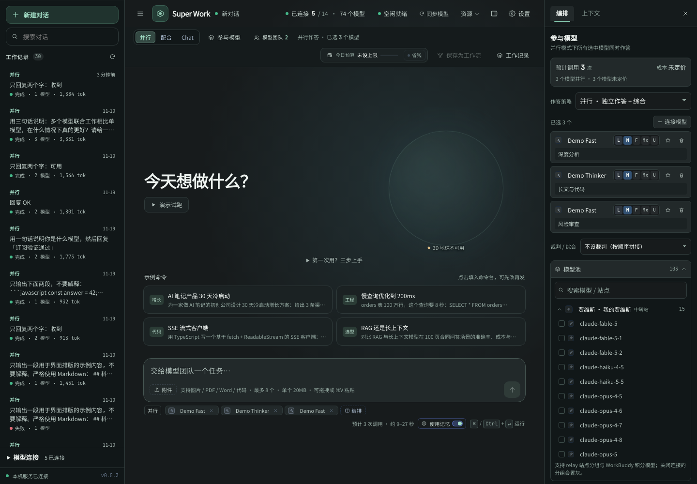

# 贾维斯（我的贾维斯）接入说明

> 本机已通过 Super Work 的「中转站」能力接入 **我的贾维斯**（api.aijws.com）。本文记录接入方式、模型范围与验证方法；不包含任何 API Key。

## 1. 服务信息

| 项 | 值 |
|---|---|
| 平台 | 我的贾维斯（贾维斯官网） |
| 协议 | OpenAI 兼容 |
| Base URL | `https://api.aijws.com/v1` |
| 凭证 | API Key（本机 DSH 已保存 `JWS_API_KEY` / `JWS1_API_KEY`） |
| 计费 | 按量；以站点账单为准，Super Work 内为估算 |

## 2. 本机已接入的账号

| 账号 | 凭证 | 模型数 | 模型范围 |
|---|---|---:|---|
| 贾维斯 · 我的贾维斯 | `JWS_API_KEY` | 15 | Claude Fable / Haiku / Opus / Sonnet 系列（含 4.x、5.x） |
| 贾维斯 · jws1 | `JWS1_API_KEY` | 7 | Codex Auto Review、GPT-5.6 Sol、GPT-6 Astra/Sol、GPT-6.1/6.2 Sol |

两个账号都出现在 **设置 → 中转站**，模型进入 **参与模型 → 模型池** 的「贾维斯 · …」分组。模型 ID 在 Super Work 内会带中转站前缀，例如 `relay_xxx::claude-haiku-4-5`，选择时不需要手动输入。

## 3. 如何自己添加

1. 打开 **设置 → 中转站 → 添加中转站**；
2. 预设选择「贾维斯官网（我的贾维斯）」，Base URL 已预填 `https://api.aijws.com/v1`；
3. 填入 API Key（或从本机 DSH 凭证复制，见下）；
4. 保存后自动 `GET /models` 拉取模型，勾选需要的模型导入；
5. 在「参与模型」里选中贾维斯模型，即可用于并行、配合或 Chat。

## 4. 复用本机 DSH 凭证

DSH 的只读凭证文件：`~/.dsh/.credentials.yaml`，其中：

- `refs.JWS_API_KEY` → 「我的贾维斯」账号；
- `refs.JWS1_API_KEY` → 「jws1」账号。

Super Work 不会自动上传或提交这些值；当前两个中转站账号已在本机加密数据目录 `~/.super-work` 中保存。**不要把 Key 写进仓库、截图或 issue。**

## 5. 验证记录

- 2026-11-21：通过 Super Work API 用 `claude-haiku-4-5` 运行「只回复两个字：收到」→ 返回 `收到`；
- 同日用 `gpt-6.1-sol` 运行同一命令 → 返回 `收到`；
- 模型池显示两个贾维斯分组，共 22 个模型；顶栏模型总数从 52 增加到 74。

## 6. 边界

- 站点模型目录可能变化；用「同步模型」/重新 discover 刷新。
- 不同 Key 的可用模型与价格可能不同；以站点控制台为准。
- 本项目与「我的贾维斯」无隶属关系；名称与模型归其权利人所有。
