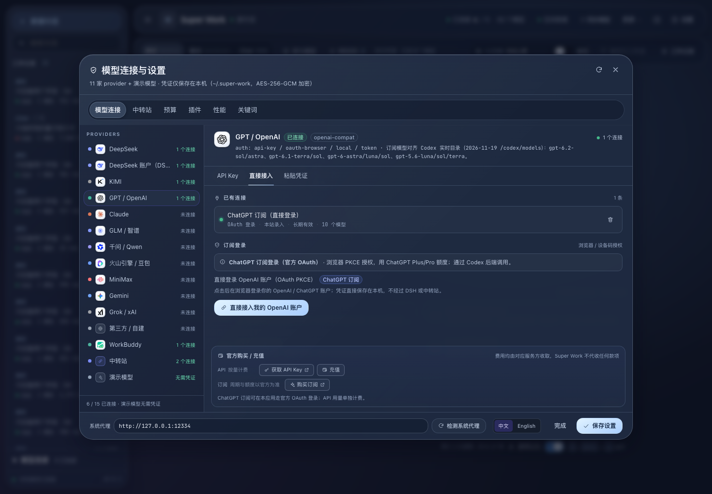

# OpenAI 直接接入账户

> Super Work 的 OpenAI 选项现在默认走 **直接接入本机账户**，不再把 DSH 的「本机复用」当作主入口。

## 当前状态

| 项 | 值 |
|---|---|
| provider | `openai` |
| 连接方式 | `oauth-browser`（ChatGPT 订阅官方 OAuth） |
| 凭证来源 | `user`（本站直接管理） |
| 账号 | ChatGPT 订阅账号 `…ff585e` |
| 模型 | GPT-6.2 Sol/Astra、GPT-6.1 Terra/Sol、GPT-6/5.6 系列共 10 个 |
| 有效期展示 | 长期有效 |

## UI 变化

- OpenAI 的 tab 从「订阅登录」改为 **「直接接入」**，默认打开；
- OpenAI 下隐藏「本机复用」入口，避免误把 DSH 登录态当成主连接；
- 登录按钮文案：**「直接接入我的 OpenAI 账户」**；
- 已有连接显示为「ChatGPT 订阅（直接登录） · OAuth 登录 · 本站录入」。

## 两条路径的区别

| 方式 | 凭证 | 刷新 | 适用 |
|---|---|---|---|
| 直接接入 | 本应用保存的 OAuth access/refresh | 应用自行刷新 | 当前默认 |
| DSH 本机复用 | 读取 `~/.dsh/.credentials.yaml` | 需 DSH 刷新后重新导入 | 保留给其他平台 / 备用 |

当前 OpenAI 连接已经从 `source=local` 切换为 `source=user`，并实测调用通过（`gpt-6.2-sol` 返回 `OA`）。如果以后需要重新授权，点击「直接接入我的 OpenAI 账户」按浏览器提示完成即可。

## 实现位置

- `apps/web/src/components/SettingsModal.tsx`：OpenAI 默认 tab、隐藏本机复用、tab 文案
- `apps/web/src/components/AuthPanel.tsx`：直接接入文案与 OAuth 按钮
- `apps/web/src/lib/format.ts`：有效期统一「长期有效」
- 连接记录：`~/.super-work` 本地加密凭据库

## 安全

- OAuth 凭证仅存本机 `~/.super-work`，不写入仓库、不经过中转站；
- 应用刷新时可能轮换 refresh token，这是直连模式的正常行为；
- 如果 DSH 也要继续使用同一个 OpenAI 账户，建议只在一边使用 OAuth，避免双方各自轮换令牌。
