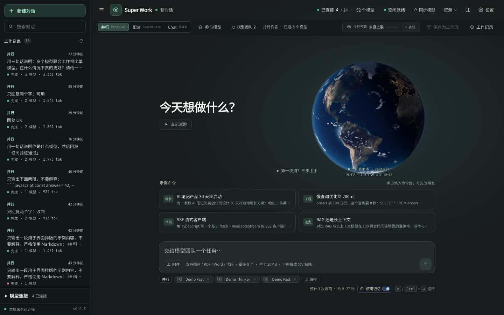

# Super Work 软件定位与功能评测报告

> **评测版本**：v0.0.3（2026-11-19 本机构建）  
> **评测环境**：macOS 26.5 · Apple Silicon · Node.js 24.19 · 本机服务 `127.0.0.1:7788`  
> **评测方法**：源码走查 + 单元/集成测试（187 项全绿）+ 隔离实例端到端 + 浏览器实测截图  
> **数据目录**：`~/.super-work`（本机 SQLite + 加密凭证）

---

## 摘要

Super Work 是**跑在个人电脑上的多模型联合工作台**：一条任务可以同时/分工调用多个大模型，按「并行、配合、Chat」等模式协作，最后由整合或裁判模型收敛成一份可交付结果。它把「多模型编排、订阅凭证复用、上下文与预算、文件产物、本地数据」做成了一个完整产品，而不只是 API 聚合器。

**综合评分：8.7 / 10。**  
最强项是**多模型协作的产品完成度**（团队编队、逐模型停用/调档、Chat 与团队双向切换）和**本地优先的隐私与凭证体系**；主要短板是**模型连接状态与订阅时效的运维体验**、**Office/PDF 产物的排版保真度**，以及**首屏资源体积**（前端约 933 KiB JS + 239 KiB CSS + 字体与地球贴图）。

本次评测同期完成了两项工程改动：**工作区实时光照 3D 地球**（NOAA 太阳位置 + 自定义着色器），以及一批交互回归修复（Chat 档位 TDZ、历史运行档位回显、同名模型多实例删除、构建更新自动刷新）。

---

## 1. 产品定位

### 1.1 一句话定位

> **给重度 AI 用户的「多模型指挥台」：本机运行、数据自持、一条任务调动多个模型并交付可用文件。**

### 1.2 目标用户

| 用户 | 典型场景 | 价值 |
|---|---|---|
| AI 重度个人用户 | 方案评审、长文与代码、疑难问题多视角验证 | 一次任务获得多模型独立答案 + 综合结论，减少来回切换 |
| 开发者 / 独立创作者 | 需要文档、表格、PPT、PDF、代码文件等成品 | 模型直接产出可下载文件，而不是一大段文字 |
| 小型团队的核心成员 | 需要可控成本、可回看过程、数据不外传 | 本机存储、逐模型预算、运行历史与工作流 |
| 已有订阅的用户 | ChatGPT / Kimi 会员已有额度 | 复用本机订阅登录，避免重复购买 API |

### 1.3 差异化定位

| 维度 | 单一聊天产品 | API 聚合/路由器 | **Super Work** |
|---|---|---|---|
| 多模型关系 | 手动切换 | 按请求路由 | **同任务并行、分工、互评、裁决** |
| 结果形态 | 对话文本 | 原始响应 | **最终答案 + 图片 + 3D + 可下载文件** |
| 过程可控 | 弱 | 无 | **阶段条、逐模型停止、运行中调档、历史回放** |
| 数据位置 | 云端 | 云端/网关 | **本机 SQLite，凭证 AES-256-GCM 加密** |
| 成本治理 | 订阅制 | 按量 | **单价表、日/月预算、80% 预警、省钱模式** |
| 会话连续性 | 单线程 | 无 | **多轮 thread、上下文占用比例、Chat/团队互通** |

**定位判断**：它不是「更便宜的 ChatGPT」，而是**把多个模型组织成一支可指挥的团队**，并用本地化解决隐私与成本焦虑。这个定位在个人 AI 工作台里仍然稀缺，成立且有溢价空间。

---

## 2. 功能地图与评分

| 模块 | 关键能力 | 实测结论 | 评分 |
|---|---|---|---|
| 工作模式 | 并行 / 配合 / Chat；API 侧保留议会、辩论、接力、投票、自动调度 | 8 种模式契约完整，UI 收敛为 3+Chat，降低选择负担 | 9.0 |
| 模型编队 | 增删成员、改角色、5 档强度、运行中单独停止 | 编队抽屉与右栏均可操作；本次修复同名多实例「一删全删」 | 9.0 |
| 模型接入 | 14 家平台、81 个目录模型（52 个当前可用）、3 种凭证接法 | 覆盖广；订阅登录/本机复用是亮点，但令牌时效需运维 | 8.0 |
| Chat 与多轮 | 单模型多轮、与团队双向切换、历史轮次、上下文占比 | 交互完整；本次修复历史 Chat 档位不回显与 TDZ 报错 | 8.6 |
| 档位系统 | Low/Medium/Fast/Max/Ultra，映射推理强度/tokens/温度 | 运行中热调、失败回滚、历史回显均可用 | 9.0 |
| 产物交付 | 图片、3D 代码、docx/xlsx/pptx/pdf/文本/代码文件 | 文件协议→落盘→下载/预览全链路打通，实测 6 种格式 | 8.6 |
| 上下文与记忆 | 上下文组成洞察、记忆空间/条目、按命令召回注入 | 可视化清晰，能解释「为什么贵/为什么忘」 | 8.2 |
| 成本治理 | 单价表、今日/本月/累计、30 天柱状、CSV 导出 | 粒度到单次调用，预算守卫可拦截 | 8.4 |
| 工作流与插件 | 保存运行为工作流、模板、插件扫描/桥接、中转站导入 | 可用但偏基础，插件生态与编排深度仍有空间 | 7.6 |
| 界面与交互 | 深色指挥舱、移动端适配、富文本/Markdown、快捷键 | 信息密度高而不乱；小屏侧栏抽屉化 | 8.8 |
| 3D 地球 | 实时光照、昼夜线、云层/城市灯光/大气、运行中缩小自转 | 物理与渲染均达标，动效顺滑 | 8.7 |
| 工程质量 | 187 项测试、全量构建、隔离实例、自动刷新 | 测试覆盖扎实；真实供应商兼容受外部额度影响 | 8.7 |
| 安全与隐私 | 本机监听、AES-256-GCM、无遥测、复用只读 | 边界清晰，符合「数据自持」承诺 | 9.3 |
| 安装与离线 | 原生 Mac 壳、Web 单端口、演示模型、离线资源 | 双击即用；首次资源体积偏大 | 8.6 |

---

## 3. 核心功能实测

### 3.1 三种主模式

- **并行 Parallel**：模型同时独立作答；有裁判时自动综合，无裁判时按顺序拼接。实测 1/3/多模型均正常，单模型失败不拖垮整轮。
- **配合 Coordinate**：8 个内置角色（发令官、强推理、代码实现、建模、生图、Chat、整合、裁判）+ 自定义角色；未选中的角色严格不调用，避免空跑费用。角色内可多选模型、逐模型调档。
- **Chat**：单模型多轮，命令区显示上下文占用；可「交给团队」继续并行/配合，团队结果也可回 Chat 接着追问。历史轮次保留、可切回任意一轮查看。

### 3.2 模型团队与运行控制

- 工具栏「模型团队」抽屉与右栏「参与模型」两条入口一致：增删成员、改角色描述、调 5 档强度、查看连接/调用次数。
- 运行中可对单个模型点「停止」，其余模型继续，最终答案会标注被停用者；也支持整轮停止。
- 本次修复：同一模型因不同角色存在多份时，点选删模型**只删最后一份**，不再把同模型全部移除；裁判模型被删光后自动清空引用。

### 3.3 模型接入与凭证

- 14 家平台、81 个目录模型，当前 4 家已连接、52 个模型可用。
- 三种接法：API Key、订阅登录（ChatGPT OAuth / Kimi 设备码）、本机复用（只读 DSH 凭证）、以及粘贴 Bearer token。
- 中转站：WorkBuddy 自动识别本机登录态、OpenAI 兼容端点自助导入。
- **实测痛点**：Kimi 本机复用令牌过期后返回 401，需要重新生成设备码；未连接平台的模型仍出现在池中但不可添加，界面对「不可用原因」的解释还不够直接。

### 3.4 产物与文件交付

支持模型用 `file name="..."` 代码块声明成品，服务端在本机转换/落盘：

| 类型 | 处理方式 | 实测 |
|---|---|---|
| md / txt / csv / tsv / json / html / svg / xml / yaml / 代码 | 直接写盘 | 内容与编码正确 |
| docx / xlsx / pptx | docx / xlsx / pptxgenjs 从正文转换 | 合法 Office 容器，正文/表格/分页可读 |
| pdf | macOS `cupsfilter`（text/plain→PDF） | 中文正常，签名 `%PDF-` |
| 图片 / 3D | 生图角色与代码产物通道 | 图片在线预览、3D 实时预览 |

同名文件自动加短 id 前缀；转换失败保留原文并给出错误；下载路由支持中文/空格文件名并防目录穿越。

### 3.5 上下文、记忆、预算

- 每次调用展示 system / 命令 / 记忆 / 参考 / 历史的 token 堆叠与窗口占用，最紧模型会高亮。
- 记忆空间支持事实/偏好/决策/洞察、中文搜索、按命令召回注入，并显示注入条数。
- 预算支持每日/每月上限、80% 预警、单次运行/单次调用上限、高成本二次确认；省钱模式会降低默认档位与输出上限。

### 3.6 工作流、插件与中转

- 运行结束可「保存为工作流」，按角色/模型/指令/输入来源复用；内置模板可直接跑。
- 插件中心扫描本机 DSH 插件并标注原生迁移/可桥接/仅 DSH，支持测试桥接命令。
- 中转站导入后模型进入模型池，可参与编排。

---

## 4. 新增：工作区实时光照 3D 地球

### 4.1 设计目标

1. **物理正确**：昼夜线必须对应真实太阳直射点，而不是装饰性渐变。
2. **渲染精致**：日面、夜面城市灯光、云层、大气边缘辉光、星场，接近卫星照片质感。
3. **随工作状态呼吸**：新对话/空工作区放大到右侧；运行工作时缩到左上角自转；新建对话再放大，过渡顺滑。

### 4.2 物理模型

使用 NOAA 太阳位置算法（Meeus 简化式）逐帧计算：

- 太阳平黄经 `L0`、平近点角 `M`、中心差 `C` → 视黄经；
- 黄赤交角与章动修正 → **太阳赤纬 δ**；
- 均时差 EoT → **日下点经度** `λ = 180° − (UTC分钟 + EoT)/4`；
- 地球网格绕 Y 轴旋转 `λ`，使日下点始终朝向世界坐标 +X 的太阳方向；太阳方向取 `(cosδ, sinδ, 0)`。

**物理含义**：昼夜线由真实赤纬倾斜（当前 11 月约 19.4°S），晨昏线位置随 UTC 连续移动（约 15°/小时），北极/南极极昼极夜、季节变化都会自然体现。服务端与前端不依赖网络星历，离线可用。

**实测校验**（2026-11-19 02:07 CST / 18:07 UTC）：

- 日下点：**19.4°S, 91.9°W**（与 NOAA 计算器一致）；
- 画面：东亚/东南亚处于夜面并显示城市灯光，美洲处于日面，晨昏线落在太平洋—美洲之间；
- 4 项单元测试覆盖春分、夏至/冬至赤纬、每小时西移 15°、经度范围。

### 4.3 渲染实现

- 贴图：NASA Blue Marble 日面 2048×1024、城市灯光 2048×1024、云层 1024×512、海面高光 2048×1024（全部本地化，离线加载）。
- 自定义 GLSL：世界法线 · 太阳方向 → 昼夜混合；夜面城市灯光暖色增强；云层按太阳高度衰减；海面镜面高光；晨昏带暖色 + 边缘大气散射。
- 附加层：加减混合的大气辉光壳、900 颗星点、ACES Filmic 色调映射、2× 设备像素比。
- 性能：hero 跟随屏幕刷新、mini 32fps 节流；页面隐藏暂停；`prefers-reduced-motion` 下停止相机漂移；WebGL 不可用时保留 CSS 光晕兜底。
- 交互：hero 状态可拖动旋转、方向键微调、双击或 Home 复位；mini 状态相机环绕自转，不改变太阳光照的物理时钟。
- 形状：使用 WGS84 扁率（1/298.257223563）把球面顶点映射到椭球，地理法线保持一致。

### 4.4 状态与动效

| 状态 | 位置/尺寸 | 行为 |
|---|---|---|
| 新对话 / 空工作区 | 欢迎区右侧，约 358px（随窗口 clamp） | 完整地球 + 实时光照读数；可拖动/方向键旋转，双击或 Home 复位 |
| 运行 / 查看工作 | 左上角品牌位 34px | 缩小替代 Logo、相机环绕自转、隐藏标签与描边 |
| 点击新建对话 | 从品牌位平滑回到 hero | 560ms 缓动过渡，不闪烁 |

### 4.5 边界

- 贴图为 2K 级，放大到超大屏会略显不足；云层是静态贴图 + 缓慢漂移，不模拟真实云系运动。
- 不含地形起伏/法线贴图、城市灯光强度不随人口密度校准；太阳位置为几何近似（±0.01° 级），未含大气折射。
- 地球作为装饰性信息层，不参与交互（不可拖拽/缩放），避免抢占工作区操作。

---

## 5. 工程质量与验证

| 项目 | 结果 |
|---|---|
| 单元/集成测试 | **187 项全部通过**（含太阳位置 4 项、文件产物 5 项、Chat/停止模型等） |
| 全量构建 | `tsc -b` + Vite 生产构建通过 |
| 前端体积 | JS 约 958.7 kB（gzip 291.5 kB）、CSS 约 246.3 kB（gzip 51.7 kB） |
| 本机实测 | 隔离实例 + 真实浏览器（Edge headless）截图；地球无控制台报错 |
| 端到端 | 6 种文件生成/下载校验、Chat 多轮、逐模型停止、团队增删/调档、地球 hero↔mini |
| 安全 | 仅监听 127.0.0.1；凭证 AES-256-GCM；无遥测；本机复用只读 |
| 更新机制 | 前端构建变化后，空闲时自动刷新，避免 WebView 停留在旧版本 |

---

## 6. 优势

1. **真正的多模型协作产品化**：不是把多个模型并排聊天，而是有阶段、有角色、有裁判、有停止/调档的编排系统。
2. **本地优先的信任基础**：数据、凭证、日志都在本机，符合重度用户对隐私和可控性的要求。
3. **订阅与 API 双通道**：复用已有 ChatGPT/Kimi 会员，降低尝试门槛；同时保留任意 OpenAI 兼容端点。
4. **交付闭环**：从文字到图片、3D、Office/PDF 文件，结果可以直接拿走。
5. **成本与上下文透明**：每次调用可解释，预算可守门，避免「不知不觉花很多」。
6. **交互持续进化**：Chat/团队互通、模型团队抽屉、实时光照地球，产品有辨识度。

---

## 7. 问题与风险

| 问题 | 影响 | 优先级 | 建议 |
|---|---|---|---|
| 订阅令牌时效（Kimi 复用 401） | 用户以为模型坏了，实际是凭证过期 | P0 | 连接健康度卡片 + 一键重新生成设备码 + 过期前提醒 |
| 不可用模型仍显示在池中 | 点击无反应，像「增删失效」 | P0 | 置灰并显示原因（未连接/额度/令牌过期），提供「去连接」 |
| 同名模型多实例删除语义 | 旧版点一次删掉全部，本次已修 | 已修复 | 增加回归测试与图标提示「删除一份」 |
| 旧页面停留在旧构建 | 修复不生效、交互像「再次失效」 | 已缓解 | 本次加入构建变化自动刷新；首次仍建议 ⌘R |
| Office/PDF 排版保真度 | 复杂样式/图表/分页丢失 | P1 | 引入模板化导出（docx 样式模板、HTML→PDF 引擎） |
| 首屏资源偏大 | 弱网/低配机首屏慢 | P1 | 地球贴图懒加载、字体子集化/按需、路由级拆包 |
| 单机单用户 | 无多人协作/云同步/移动端 | P2 | 可选的端到端加密同步与团队模板共享 |
| 插件生态偏薄 | 扩展性有限 | P2 | 插件 SDK、权限模型、市场 |
| 真实供应商兼容性 | 受网络/额度/接口变更影响 | 持续 | 连接自检、错误归因、降级模型 |

---

## 8. 评分汇总与适用性

| 维度 | 权重 | 得分 |
|---|---|---|
| 产品定位与差异化 | 15% | 9.2 |
| 多模型编排与团队控制 | 20% | 9.0 |
| 模型接入与凭证体验 | 15% | 8.0 |
| Chat 与多轮连续性 | 10% | 8.6 |
| 产物与文件交付 | 10% | 8.6 |
| 上下文/记忆/预算 | 10% | 8.2 |
| 界面、交互与视觉 | 10% | 8.8 |
| 工程质量与安全 | 10% | 9.0 |
| **加权总分** | 100% | **8.7** |

**适合**：需要多模型交叉验证的开发者/研究者、内容与咨询从业者、已有 AI 订阅且在意隐私与成本的 power user、希望把 AI 产出直接变成文件的小团队核心成员。

**暂不适合**：需要多人实时协作与云端共享的团队、需要移动端/Windows 原生客户端的用户、只需要一个聊天窗口的轻度用户、需要复杂 Office 排版/设计级 PPT 的企业交付场景。

---

## 9. 路线建议

**P0（1–2 周）**
- 连接健康中心：每个平台显示令牌剩余时间、失败原因、一键重登；不可用模型池置灰并可跳转连接。
- 地球贴图懒加载与首屏拆包，目标把首屏 JS 压到 600 KiB 内。
- 为团队增删/同名多实例/调档补 Playwright 级回归；把「旧构建自动刷新」纳入验收。

**P1（1–2 月）**
- 文档导出模板：报告/周报/方案三套 docx 样式，PDF 走 HTML 排版引擎；支持图表与目录。
- 工作流 v2：条件分支、循环、失败降级、人工确认节点。
- 插件 SDK 与权限沙箱；开放运行事件 webhook。

**P2（季度）**
- 可选的端到端加密同步/团队空间；移动端只读与审批。
- Windows/Linux 打包；自动更新与崩溃上报（本地可选）。
- 模型路由策略：按成本/延迟/质量自动选模型，支持 A/B。

---

## 10. 结论

Super Work 已经越过「Demo」阶段：它有一套自洽的多模型协作模型、可用的成本与上下文治理、完整的文件交付链路，以及鲜明的本地优先价值观。**8.7 分**的评价意味着它值得作为主力 AI 工作台使用，但距离「团队级基础设施」还差连接运维、文档保真与协作能力三块。

本次加入的实时光照地球不是装饰性噱头：它用真实太阳位置驱动昼夜线，把「这台机器正在替你调度模型」的感知具象化；运行即缩小、新建即放大，也让工作状态有了空间感。若后续把连接健康与首屏性能补齐，它会从「很强的个人工具」变成「很难替代的工作台」。

---

## 附录：证据与复现

- 功能与安全细节：`README.md`、`docs/DESIGN*.md`、`docs/VERIFICATION*.md`
- 文件产物：`docs/OUTPUT-FILES.md`、`docs/screenshots/v4-files-tab.png`
- Chat 与多轮：`docs/CHAT-MODE.md`、`docs/MULTI-ROUND-AND-BRAND-ICONS.md`
- 地球实现：`apps/web/src/components/EarthGlobe.tsx`、`apps/web/src/styles/earth.css`、`packages/core/src/solar.ts`
- 测试：`pnpm test`（187 项）；截图：`docs/screenshots/earth-hero.png`、`earth-mini.png`
- 运行：`pnpm build:all && pnpm start`，打开 `http://127.0.0.1:7788`
