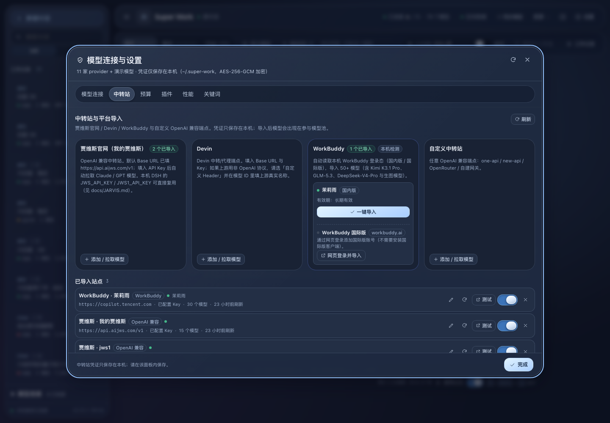

# WorkBuddy 国际版接入（v1.0.1 Verse）

> 在 Super Work 中直接接入 WorkBuddy 国际版（workbuddy.ai），与国内版账号并存。

## 与国内版的区别

| 区域 | 账号来源 | 目录/对话端点 | 代表模型 |
|---|---|---|---|
| 国内版 | 本机 WorkBuddy 登录态 | `copilot.tencent.com` / `codebuddy.cn` | Hy4、GLM-5.3、DeepSeek-V4-Pro、Kimi-K3、MiniMax |
| 国际版 | 网页登录 workbuddy.ai（无需国际版客户端） | `www.workbuddy.ai` | GPT-5.6、Gemini-3.5-Flash、GLM-5.3、Kimi-K3 等 |

两个区域是**独立账号、独立积分、独立模型目录**；在「中转站」里会显示两条 WorkBuddy 账号，模型池按账号分组。

## 使用步骤

1. 打开 **设置 → 中转站 → WorkBuddy**；
2. 找到「WorkBuddy 国际版」卡片，点 **「网页登录并导入」**；
3. 浏览器打开 `www.workbuddy.ai` 授权页，完成登录/扫码；
4. 回到 Super Work，页面会自动轮询并在成功后导入模型；
5. 在「参与模型」里选择「WorkBuddy 国际版 · …」的模型。

登录轮询约每 3 秒一次，有效期 10 分钟；超时重新点一次即可。

## 实现

- 服务端：`apps/server/src/relays.ts`
  - `startWorkBuddyOAuth("global")` → `POST https://www.workbuddy.ai/v2/plugin/auth/state?platform=workbuddy`
  - `pollWorkBuddyOAuth(loginId)` → 轮询 `/v2/plugin/auth/token`，成功后用 Bearer 读 `/v2/plugin/login/account`
  - 凭证写入 `~/.dsh/workbuddy-vault/global/<accountId>.json`，调用现有 `importWorkBuddy({region:"global"})` 自动发现并导入模型；
- API：`POST /api/relays/local/workbuddy/oauth/start`、`POST /api/relays/local/workbuddy/oauth/poll`；
- UI：`apps/web/src/components/RelaySettings.tsx`。

## 安全与边界

- 登录凭证只保存在本机 `~/.dsh/workbuddy-vault`，Super Work 不打印、不上传；
- 国际版模型目录约 28 个，实际可用性/积分/活动以 WorkBuddy 上游为准；
- 国际版没有国内版的 `/v2/chat/busy` 繁忙探针（上游 404），因此不显示排队徽标；
- 上游若限制非官方客户端，登录或调用可能失效，需要重新登录。
