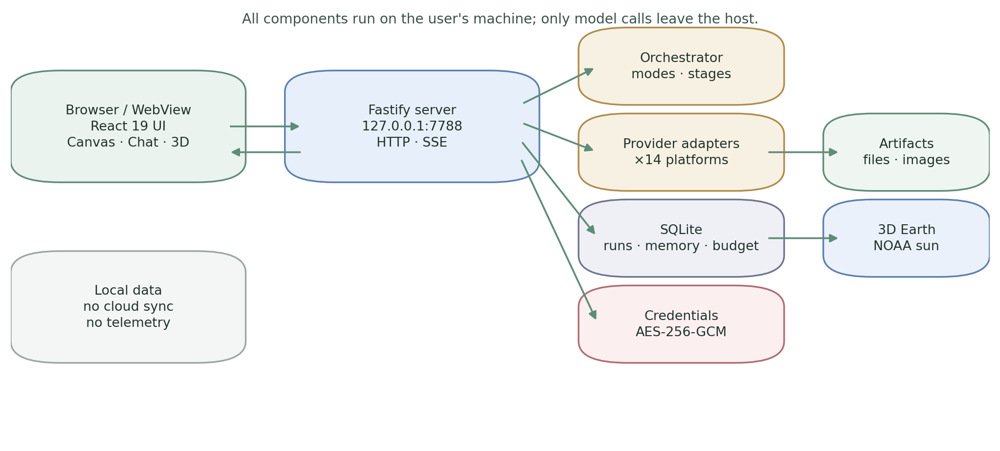
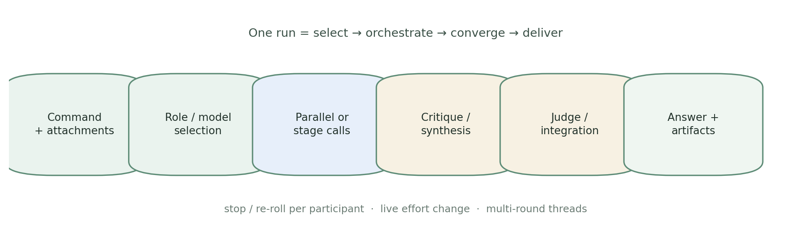

# Super Work: A Local-First Multi-Model Orchestration Workbench

**Authors:** Super Work Contributors  
**Affiliation:** Open-source project, https://github.com/zengpu987-ctrl/super-work  
**Version:** v0.0.3 · 2026-11-19 · License: Apache-2.0

---

## Abstract

Single-model chat interfaces are convenient but poorly suited to work that benefits from independent perspectives, division of labour, and verifiable convergence. Existing multi-agent frameworks target developers and cloud deployments, while API gateways optimize routing rather than collaboration. We present **Super Work**, an open-source, local-first workbench that organizes multiple large language models (LLMs) into a controllable team. Users select participants and a collaboration mode (parallel, role-based coordination, or multi-turn chat); the system streams individual contributions, supports per-participant stopping and five effort levels, injects memory and context budgets, and converges outputs through integration or judging roles. A unified artifact protocol turns model text into downloadable Markdown, CSV, code, DOCX, XLSX, PPTX, and PDF files. A real-time Earth visualization, driven by NOAA solar-position mathematics and a custom WebGL shader, reflects the actual day/night terminator. All credentials and run data remain on the user's machine; the server binds to loopback, and credentials are encrypted with AES-256-GCM. The v0.0.3 implementation comprises 14 provider adapters, 81 catalogued models, eight orchestration modes, five effort levels, and 187 passing tests. We report the architecture, design rationale, functional evaluation, limitations, and a roadmap for community collaboration.

**Keywords:** multi-model orchestration; local-first; LLM workbench; multi-agent collaboration; artifact generation; WebGL visualization

## 摘要

单模型聊天界面适合问答，却难以胜任需要多视角、分工与可验证收敛的工作。现有多智能体框架多面向开发者与云端部署，API 网关则侧重路由而非协作。本文提出 **Super Work**：一个开源、本地优先的多模型联合工作台，把多个大语言模型组织成一支可指挥的团队。用户选择参与模型与协作模式（并行、角色配合、多轮 Chat），系统流式呈现各自贡献，支持逐模型停止与五档强度，注入记忆与上下文预算，并通过整合/裁判角色收敛为最终答案。统一的文件产物协议把模型文本转成可下载的 Markdown、CSV、代码、DOCX、XLSX、PPTX 与 PDF。一个由 NOAA 太阳位置算法与自定义 WebGL 着色器驱动的实时地球，准确反映真实昼夜线。全部凭证与运行数据留在本机：服务仅监听回环地址，凭证以 AES-256-GCM 加密。v0.0.3 包含 14 家平台适配、81 个目录模型、8 种编排模式、5 档强度与 187 项通过测试。本文报告其架构、设计取舍、功能评测、局限与社区协作路线。

**关键词：** 多模型编排；本地优先；大模型工作台；多智能体协作；文件产物；WebGL 可视化

---

# Part I — English

## 1. Introduction

Large language models are increasingly used for open-ended knowledge work: drafting documents, reviewing designs, writing code, and analysing data. Yet most interfaces expose one model at a time. Users manually copy answers between tabs, lose provenance, and cannot tell whether a confident answer survived an independent check. Multi-agent frameworks such as AutoGen, MetaGPT, and CrewAI demonstrate that role decomposition and inter-agent critique can improve complex tasks, but they assume a developer who writes orchestration code and typically run in a cloud environment. Conversely, API gateways and routers make many models reachable but treat each call as an isolated request.

This paper asks a product-level question: *what would a multi-model workbench look like if it were designed for knowledge workers rather than agent developers, and if privacy, cost, and deliverability were first-class constraints?* Our answer, Super Work, makes four contributions:

1. **A controllable multi-model team.** Eight orchestration modes, eight configurable roles, per-participant stopping, and five effort levels that map to reasoning depth, token budgets, and temperature.
2. **A local-first architecture.** A loopback-only Fastify server, encrypted credentials, local SQLite persistence, no telemetry, and read-only reuse of existing desktop credentials.
3. **A delivery-oriented output layer.** A file protocol that converts model text into office documents and code files, with download and preview in the UI, alongside image and 3D artifacts.
4. **An ambient, physically grounded visualization.** A WebGL Earth whose terminator follows the real subsolar point, shrinking to a spinning status orb while work runs.

We evaluate the implementation functionally: 187 automated tests, isolated end-to-end runs with mock and local relay models, file-signature and content checks for six output formats, and browser-level interaction checks. The contribution is not a new model or a new multi-agent algorithm; it is an integrated, reproducible system and an open invitation to harden it together.

## 2. Related Work

**Multi-agent orchestration.** AutoGen models conversations among configurable agents; MetaGPT encodes software-engineering roles and standard operating procedures; ChatDev simulates a software company. These systems show gains from decomposition and critique, but their unit of use is a script or notebook. Super Work keeps the orchestration engine but exposes roles, stages, effort, and stopping as UI-level controls, and treats the final deliverable—including office files—as the product.

**Model gateways and routers.** OpenRouter and LiteLLM normalize provider APIs and route requests. They solve reachability and pricing transparency, not collaboration semantics. Super Work includes provider adapters and a relay importer, but its core value is what happens *between* calls: parallel answers, critique, synthesis, and judging.

**Desktop AI clients.** Chat clients and IDE assistants optimize a single conversational loop. Super Work is closer to a control room: a run has stages, participants, budgets, and artifacts, and can be inspected later. The trade-off is higher interaction complexity, which we mitigate through three primary modes and presets.

**Local-first and privacy.** Local-first software prioritizes user ownership of data and offline capability. Super Work extends this stance to credentials and inference logs: only model requests leave the host; all state is in a user-controlled directory.

## 3. System Architecture

Super Work is a TypeScript monorepo with a React 19 web client, a Fastify 5 server, and shared packages for contracts, providers, orchestration, memory, workflows, and files (Figure 1). The server listens on `127.0.0.1:7788`; the macOS application is a thin WKWebView shell that starts and monitors the same server. The browser receives run events over Server-Sent Events (SSE), including token deltas, stage transitions, participant completion, artifact events, and errors.

Persistence uses `node:sqlite` with no native modules. Run records include the command, participants, stages, per-model results, usage, artifacts, and thread metadata. Credentials are encrypted with AES-256-GCM using a locally generated key with file mode 600. The client never receives raw credentials.

A single run follows a predictable pipeline (Figure 2): the command and attachments are normalized; participants and roles are resolved; the orchestrator invokes models in parallel or by stage; intermediate results may be critiqued and synthesized; a judge or integrator produces the final answer; artifacts are materialized and announced. Every call records latency, token usage, effort, and context composition.

## 4. Orchestration Model

Super Work exposes three primary modes and retains five programmatic modes.

**Parallel.** All selected participants answer independently and stream concurrently. An optional judge receives bounded excerpts and produces a synthesis; without a judge, answers are concatenated in order. This mode is useful for comparison and fact-checking, and its cost is predictable.

**Coordinate.** Eight roles—commander, deep reasoning, coding, 3D modelling, image generation, chat, integration, and judging—form a pipeline. Roles that are not configured are never called, avoiding empty or redundant requests. Each role may contain several models, and each model has its own effort level.

**Chat.** Exactly one model is active; the interaction is a multi-turn thread with a visible context-usage ratio. A chat can be handed off to the team (becoming a parallel or coordinated run) and a team result can be continued in chat. This addresses a common failure of orchestration tools: once a heavy run ends, users cannot easily ask a follow-up.

**Control surfaces.** Each participant can be stopped independently while others continue; the final answer records the interruption. Effort can be changed during a run; the new level applies to the next call and rolls back on failure. Every participant exposes stage, latency, tokens, and context composition. The runtime treats provider errors, timeouts, and partial streams as data: failures remove only that participant's contribution, and judge failure falls back to the most complete answer.

**Effort mapping.** Low/Medium/Fast/Max/Ultra multiply the output-token budget (0.5×, 1×, 1.3×, 2×, 3×), adjust temperature (0.30/0.50/0.40/0.60/0.70), and inject a strength hint into the system prompt. For providers that expose native reasoning controls, the adapter also forwards the corresponding parameter; otherwise the prompt-and-budget mapping remains deterministic.

**Table 1. Primary collaboration modes.**

| Mode | Models | Stages | Best for |
|---|---|---|---|
| Parallel | 1–N, concurrent | answer → optional judge | comparison, review, fact-checking |
| Coordinate | 8 roles, multi-model | command → execute → integrate → judge | complex, responsibility-sensitive work |
| Chat | exactly 1 | multi-turn thread | follow-ups, exploration, hand-off |

**Table 2. Effort levels and their deterministic mapping.**

| Level | Max-token multiplier | Temperature | Intended behaviour |
|---|---:|---:|---|
| Low | 0.5× | 0.30 | shortest answer, minimal reasoning |
| Medium | 1.0× | 0.50 | conclusion plus key evidence |
| Fast | 1.3× | 0.40 | actionable steps and code |
| Max | 2.0× | 0.60 | hypotheses, counterexamples, trade-offs |
| Ultra | 3.0× | 0.70 | exhaustive options, risks, delivery-ready draft |

## 5. Context, Memory, and Cost

Long multi-model runs fail in two silent ways: context overflow and unaccounted spend. Super Work makes both visible.

**Context insight.** Before each call, the runtime composes system prompt, command, recalled memory, reference material, and conversation history. The UI displays a token-stacked bar per call, the window occupancy, and the tightest model. This turns "why did the model forget?" into an inspectable budget problem.

**Memory.** A memory space stores facts, preferences, decisions, and insights. Entries are searchable in Chinese, can be enabled or disabled, and are recalled and injected by command with a visible count. Memory is local and never uploaded; imported desktop-memory seeds are one-way.

**Budgets.** A configurable price table yields per-run and aggregate costs. Daily and monthly caps, 80% warnings, per-run and per-call limits, high-cost confirmation, and a cheap mode guard spending. The system distinguishes estimation from provider billing and records both token categories.

## 6. Artifact Delivery

Text-only output is a poor deliverable. Super Work defines a lightweight, model-agnostic file protocol: a fenced block whose info string contains a filename, for example `file name="report.docx"`. The orchestrator extracts these blocks, emits artifact events, and replaces them in the user-visible answer with a short placeholder. Ordinary code fences are untouched.

The server materializes artifacts in a per-run directory. Markdown, text, CSV, JSON, HTML, SVG, XML, YAML, and source files are written directly. DOCX is generated from Markdown with the `docx` library; XLSX uses SheetJS for CSV/JSON tables; PPTX uses PptxGenJS with `##`-delimited slides; PDF uses the macOS `cupsfilter` text-to-PDF path. Failures preserve the source text and surface an error instead of silently dropping content. Download routes support Unicode filenames and validate paths against traversal.

Images from a designated image role and HTML/Three.js scenes from a 3D role use the same artifact channel. The UI provides a file tab with download and preview, and chat renders artifacts directly under the assistant message.

**Table 3. Artifact formats and materialization paths.**

| Format | Materialization | Verified |
|---|---|---|
| Markdown, text, CSV, JSON, HTML, SVG, XML, YAML, source code | direct UTF-8 write | content and encoding |
| DOCX | `docx` from Markdown | valid ZIP, readable XML |
| XLSX | SheetJS from CSV/JSON | rows round-trip |
| PPTX | PptxGenJS, `##` slides | slide text |
| PDF | macOS `cupsfilter` | `%PDF-`, Chinese rendering |
| PNG/JPG/WebP, Three.js HTML | image role / 3D role | preview and download |

## 7. Physically Grounded Earth Visualization

The workspace includes a real-time 3D Earth. It is not a decorative loop: the terminator is computed from the actual solar position. We implement the NOAA/Meeus solar-position approximation: Julian day, mean longitude and anomaly, equation of centre, apparent longitude, nutation-corrected obliquity, declination, and equation of time. The subsolar longitude is `180° − (UTC minutes + EoT)/4`. The Earth mesh is rotated so that this longitude faces a fixed sun direction; the sun vector is tilted by the declination. The resulting day/night boundary therefore reflects season, UTC, and polar day/night without an ephemeris service.

Rendering uses NASA Blue Marble imagery, city lights, clouds, and a specular ocean mask, combined in a custom GLSL shader with a soft terminator, twilight tint, cloud attenuation, specular highlight, and atmospheric rim. The mesh is scaled to the WGS84 ellipsoid, preserving geodetic surface normals. An additive glow shell, a star field, and ACES tone mapping complete the scene. The globe is large beside the welcome copy and animates to a 34-pixel spinning logo at the top-left while a run is active; a new conversation expands it again with a 560 ms eased transition. The hero view supports drag, arrow-key rotation, and double-click/Home reset; the miniature orbits the camera without altering the physical solar clock. Rendering is frame-rate driven in the hero state, capped at 32 fps in the miniature, paused when hidden, and reduced-motion aware.

## 8. Implementation and Evaluation

The implementation comprises approximately 350 tracked source and documentation files. The stack is Node.js 24, TypeScript strict mode, Fastify 5, React 19, Vite 7, and `node:sqlite`. The web bundle is approximately 955 kB (290 kB gzip) including the new typography and document rendering; Earth textures add 1.2 MB and are loaded only by the globe module.

We evaluate functionally rather than through a user study:

- **Tests.** 187 unit and integration tests pass, covering orchestration modes, per-model stopping, effort mapping, chat, file extraction/conversion, solar position, credentials, memory, budgets, and workflows.
- **End-to-end.** In an isolated instance, a fake OpenAI-compatible model returned six file blocks; the system produced Markdown (212 B), CSV (101 B), DOCX (9.7 kB), XLSX (16.3 kB), PPTX (51.7 kB), and PDF (14 kB). ZIP containers, extracted XML, spreadsheet rows, slide text, and the `%PDF-` signature were verified. Chat, multi-round threads, and per-participant stopping were exercised through the HTTP API and the browser.
- **Solar accuracy.** Four tests cover equinox, solstice declination, the 15°-per-hour westward drift, and longitude bounds. The rendered subsolar point matched an independent NOAA calculation at the evaluation time.
- **Interface.** Headless-browser checks confirmed the file tab, download links, Unicode filenames, chat artifacts, globe hero/mini transitions, and the absence of console errors.

These results establish functional correctness, not productivity gains. A controlled study with knowledge workers remains future work.

## 9. Limitations and Discussion

First, provider credentials expire and subscription flows break; a failed token can look like a broken model. Connection health and one-click re-authentication are the highest-priority usability gap. Second, office and PDF outputs are text-level conversions; complex layouts, charts, and pagination are not preserved. Third, the interface is dense: three modes, roles, effort, budgets, memory, and artifacts are a lot to learn. Fourth, the web bundle and local textures are heavy for low-end machines. Fifth, orchestration quality depends on prompts and model behaviour; we do not yet provide a public benchmark for multi-model convergence.

The local-first stance is a deliberate constraint. It simplifies privacy and latency but rules out shared team workspaces, server-side scheduling, and cross-device sync in the current design. We regard optional, end-to-end encrypted collaboration as a later layer rather than a default.

## 10. Roadmap and Call for Collaboration

Super Work is released under Apache-2.0. We invite model vendors, infrastructure engineers, designers, researchers, and technical writers to build it with us. The near-term goals are:

1. **Connection health:** token expiry, quota, and network diagnostics with guided recovery.
2. **Provider neutrality:** a documented adapter contract and conformance tests for new vendors.
3. **Deliverable quality:** template-driven DOCX/PPTX and an HTML-to-PDF pipeline.
4. **Performance:** lazy-loaded textures, a smaller first-load bundle, and a Windows/Linux shell.
5. **Evidence:** an open benchmark for multi-model quality, cost, and latency, with reproducible prompts.

We especially welcome contributions to provider adapters, document rendering, WebGL performance, security review, Chinese/English documentation, and evaluation methodology. The governance model, contribution guide, and issue templates are in the repository; anyone can fork, propose changes, and participate in discussions.

## Appendix A. Reproducibility Checklist

- Node.js 24 and pnpm 9; `pnpm install && pnpm build:all`.
- `pnpm test` should report 187 passing tests (five additional file/solar tests may appear in later commits).
- Run with an isolated home: `SUPER_WORK_HOME=/tmp/sw-paper pnpm start`.
- Open `http://127.0.0.1:7788`; use the built-in demo models without any API key.
- Provider adapters are configured in Settings; credentials never leave `~/.super-work`.
- Earth physics can be checked against the NOAA Solar Calculator for the current UTC instant.
- File artifacts are written to `~/.super-work/artifacts/<runId>/` and served at `/api/artifacts/...`.

## Appendix B. DeepSeek Adapter Profile

| Model | Context | Max output | Reasoning | Notes |
|---|---:|---:|---|---|
| `deepseek-v4-pro` | 1,000,000 | 128,000 | yes | default strong-reasoning participant |
| `deepseek-v4.1-flash` | 1,000,000 | 384,000 | yes | long output, lower unit price |
| `deepseek-flash` | 1,000,000 | 128,000 | yes | cost-efficient default |
| `deepseek-v3.2` | 131,072 | catalog default | no | compatibility model |

The adapter uses the OpenAI-compatible chat-completions schema, maps the five effort levels to `max_tokens` and temperature, forwards native reasoning parameters when available, and records `usage` for the local price table. Detailed operational notes are in `docs/DEEPSEEK.md`.

## Appendix C. Threat Model and Mitigations

Super Work assumes a single-user machine that may run untrusted model output. The primary threats and current mitigations are:

- **Prompt injection through attachments or model output.** File contents are treated as data, not instructions; tools are not auto-executed from model text; artifact generation is restricted to a declared file protocol.
- **Credential exfiltration.** Keys are encrypted at rest, never sent to the browser, and redacted from logs; the server binds to loopback.
- **Path traversal in artifact downloads.** Run identifiers are validated, filenames are reduced to a basename, `..` is rejected, and downloads are rooted in the run directory.
- **SSRF through image/artifact URLs.** Only the explicit image pipeline fetches remote URLs, with size and timeout caps; no arbitrary URL fetch is exposed to the UI.
- **Supply-chain risk.** Dependencies are pinned by lockfile; third-party licenses and notices are tracked; CI builds from a frozen lockfile.
- **Resource exhaustion.** Per-run and per-call token budgets, concurrency limits, timeouts, and output caps are enforced before and during calls.

Residual risks remain: malicious local plugins, compromised provider SDKs, and a user exposing the loopback port through a proxy. The security policy in `SECURITY.md` defines private reporting and disclosure expectations.

## References

1. Wu, Q., et al. AutoGen: Enabling Next-Gen LLM Applications via Multi-Agent Conversation. arXiv:2308.08155, 2023.
2. Hong, S., et al. MetaGPT: Meta Programming for A Multi-Agent Collaborative Framework. arXiv:2308.00352, 2023.
3. Qian, C., et al. ChatDev: Communicative Agents for Software Development. arXiv:2307.07924, 2023.
4. CrewAI documentation. https://docs.crewai.com, 2024.
5. LangGraph documentation. https://langchain-ai.github.io/langgraph/, 2024.
6. OpenRouter API documentation. https://openrouter.ai/docs, 2025.
7. LiteLLM documentation. https://docs.litellm.ai, 2025.
8. Three.js documentation. https://threejs.org/docs/, 2025.
9. NOAA Global Monitoring Laboratory. Solar Calculator. https://gml.noaa.gov/grad/solcalc/, 2025.
10. Meeus, J. Astronomical Algorithms, 2nd ed. Willmann-Bell, 1998.
11. DeepSeek API documentation. https://api-docs.deepseek.com, 2025.
12. Apache License, Version 2.0. https://www.apache.org/licenses/LICENSE-2.0, 2004.

---

# 第二部分 — 中文

## 1. 引言

大语言模型正在承担越来越多的开放式知识工作：写方案、审设计、写代码、分析数据。但多数界面一次只暴露一个模型。用户在不同标签页之间复制答案，丢失来源，也无法判断一个自信的结论是否经得起独立复核。AutoGen、MetaGPT、CrewAI 等多智能体框架已经证明角色分解与互相批判能提升复杂任务表现，但它们假设使用者是写编排代码的开发者，且通常运行在云端。另一端的 API 网关与路由器让很多模型可达，却把每次调用当作孤立请求。

本文提出一个产品级问题：**如果为知识工作者而不是智能体开发者设计一个多模型工作台，并把隐私、成本与可交付性作为一等约束，它会是什么样？** 我们的回答是 Super Work，贡献有四点：

1. **可指挥的多模型团队**：8 种编排模式、8 个可配置角色、逐模型停止、5 档强度（映射推理深度、token 预算与温度）。
2. **本地优先架构**：仅监听回环地址的 Fastify 服务、加密凭证、本地 SQLite、无遥测、只读复用本机已有登录态。
3. **面向交付的产物层**：统一文件协议把模型文本转成 Office 文档与代码文件，并支持下载/预览；图片与 3D 走同一产物通道。
4. **有物理依据的环境可视化**：WebGL 地球的晨昏线跟随真实日下点，运行工作时缩成左上角自转的状态球。

我们做的是功能与工程评测：187 项自动化测试、隔离实例端到端、6 种文件格式的签名与内容校验、浏览器层交互检查。贡献不是新模型或新算法，而是一套可复现、可集成、可共同加固的系统。

## 2. 相关工作

**多智能体编排。** AutoGen 把智能体对话抽象为可配置图；MetaGPT 编码软件工程角色与 SOP；ChatDev 模拟软件公司。它们证明了分解与批判的收益，但使用单元是脚本/笔记本。Super Work 保留编排引擎，却把角色、阶段、档位、停止做成 UI 控制，并把最终可交付物（含 Office 文件）当作产品本身。

**模型网关与路由。** OpenRouter、LiteLLM 统一了各家 API 与计费口径，解决可达性，不解决协作语义。Super Work 包含适配器与中转导入，但核心价值发生在调用**之间**：并行作答、互评、综合与裁决。

**桌面 AI 客户端。** 聊天客户端与 IDE 助手优化单轮会话；Super Work 更接近控制室：一次运行有阶段、参与者、预算与产物，事后可回看。代价是交互复杂度更高，我们用三种主模式与预设来缓解。

**本地优先。** 本地优先软件强调用户对数据的所有权与离线能力。Super Work 把这一立场延伸到凭证与推理日志：只有模型请求离开本机，全部状态存放在用户可控目录。

## 3. 系统架构

Super Work 是 TypeScript monorepo：React 19 Web 客户端、Fastify 5 服务端，以及契约、Provider、编排、记忆、工作流、文件等共享包（图 1）。服务监听 `127.0.0.1:7788`；macOS 应用是薄壳，启动并监控同一服务。浏览器通过 SSE 接收 token 增量、阶段切换、参与者完成、产物与错误事件。

持久化使用 `node:sqlite`，零原生依赖。运行记录包含命令、参与者、阶段、逐模型结果、用量、产物与 thread 元数据。凭证以 AES-256-GCM 加密，密钥仅存本机（权限 600），客户端永远拿不到明文。

一次运行遵循可预测的流水线（图 2）：规范化命令与附件；解析参与者与角色；编排器并行或分阶段调用模型；中间结果可互评与综合；裁判/整合产出终稿；产物落盘并广播。每次调用记录耗时、token、档位与上下文组成。

## 4. 编排模型

**并行。** 所有参与者独立并发作答并流式呈现。可选裁判接收有界摘录并综合；没有裁判则按顺序拼接。适合方案对比、事实核查，成本可预测。

**配合。** 8 个角色——发令官、强推理、代码实现、建模、生图、Chat、整合、裁判——构成流水线。未配置的角色严格不调用，避免空跑；每个角色可多选模型，每个模型独立档位。

**Chat。** 只激活一个模型，多轮对话并显示上下文占用比例。Chat 可「交给团队」转为并行/配合，团队结果也可回 Chat 继续追问。这解决了许多编排工具的常见断点：重任务结束后无法自然追问。

**控制面。** 每个参与者可单独停止，其余继续，终稿记录中断；运行中可改档，下一次调用生效，失败回滚；每个参与者暴露阶段、耗时、token 与上下文组成。运行时把 Provider 错误、超时、半截流当数据：失败只移除该参与者的贡献，裁判失败则回退到最完整答案。

**档位映射。** Low/Medium/Fast/Max/Ultra 分别把输出 token 预算乘以 0.5/1/1.3/2/3，温度取 0.30/0.50/0.40/0.60/0.70，并向 system 注入强度提示（表 1、表 2）。若上游暴露原生推理参数，适配器同时转发；否则提示词 + 预算的映射保持确定性。

## 5. 上下文、记忆与成本

长程多模型运行有两种无声失败：上下文溢出与费用失控。Super Work 让两者可见。

**上下文洞察。** 每次调用前，运行时组装 system、命令、召回记忆、参考材料与历史，界面显示 token 堆叠条、窗口占用与最紧模型。把「模型为什么忘了」变成可检查的预算问题。

**记忆。** 记忆空间保存事实、偏好、决策、洞察；支持中文搜索、启停、按命令召回注入并显示条数。记忆只在本机，导入桌面记忆种子是单向的。

**预算。** 可编辑单价表给出单次与累计成本；日/月上限、80% 预警、单次运行/调用上限、高成本二次确认与省钱模式共同守门。系统区分估算与厂商账单，并记录两类 token。

## 6. 产物交付

只有文字是不合格的交付。Super Work 定义轻量、与模型无关的文件协议：带文件名的围栏代码块，例如 `file name="report.docx"`。编排器抽取这些块、发出产物事件，并在用户可见答案中替换为简短占位；普通代码块不受影响。

服务端按运行目录落盘：Markdown、文本、CSV、JSON、HTML、SVG、XML、YAML 与源码直接写入；DOCX 由 `docx` 从 Markdown 生成；XLSX 由 SheetJS 处理 CSV/JSON 表格；PPTX 由 PptxGenJS 按 `##` 分页；PDF 走 macOS `cupsfilter` 的 text→PDF 路径。失败时保留原文并给出错误，而不是静默丢弃。下载路由支持中文文件名并做目录穿越校验。

生图角色的图片与建模角色的 HTML/Three.js 场景复用同一产物通道（表 3）。界面提供文件页签（下载/预览），Chat 在助手消息下直接列出产物。

## 7. 有物理依据的地球可视化

工作区包含实时 3D 地球。它不是装饰循环：晨昏线由真实太阳位置计算。我们实现 NOAA/Meeus 太阳位置近似：儒略日、平黄经与平近点角、中心差、视黄经、章动修正的黄赤交角、赤纬与均时差；日下点经度为 `180° − (UTC 分钟 + EoT)/4`。地球网格旋转使该经度朝向固定的太阳方向，太阳向量按赤纬倾斜，因此昼夜边界自然体现季节、UTC 与极昼极夜，且不依赖星历服务。

渲染使用 NASA Blue Marble 日面、城市灯光、云层与海面高光，在自定义 GLSL 中完成软晨昏线、暖色暮光、云层衰减、镜面高光与大气边缘；网格按 WGS84 扁率映射到椭球，保持地理法线。叠加混合的大气辉光壳、星场与 ACES 色调映射。空工作区中地球在欢迎文案右侧放大，运行时以 560ms 缓动缩为左上角 34px 品牌位自转球，新建对话再放大。hero 支持拖动/方向键旋转、双击或 Home 复位；mini 只环绕相机，不改变太阳物理时钟。hero 跟随屏幕刷新，mini 限制 32fps，页面隐藏暂停，并尊重减少动态偏好。

图 3 展示 02:07（18:07 UTC）的实拍：日下点 19.4°S、91.9°W，东亚处于夜面，美洲处于日面。

## 8. 实现与评测

实现约 350 个受版本管理的源码/文档文件；Node.js 24、TypeScript strict、Fastify 5、React 19、Vite 7、`node:sqlite`。Web 包约 955 kB（gzip 290 kB），地球贴图 1.2 MB 且仅由地球模块加载。

评测以功能为主，而非用户研究：

- **测试**：187 项单元/集成测试通过，覆盖编排模式、逐模型停止、档位映射、Chat、文件抽取/转换、太阳位置、凭证、记忆、预算与工作流。
- **端到端**：隔离实例中，假 OpenAI 兼容模型返回 6 个文件块，系统产出 Markdown 212B、CSV 101B、DOCX 9.7KB、XLSX 16.3KB、PPTX 51.7KB、PDF 14KB；校验 ZIP 容器、解压 XML、表格行、幻灯片文本与 `%PDF-` 签名；Chat、多轮、逐模型停止经 HTTP 与浏览器实测。
- **太阳精度**：4 项测试覆盖春分、至点赤纬、每小时西移 15° 与经度边界；渲染日下点与独立 NOAA 计算一致。
- **界面**：无头浏览器确认文件页签、下载链接、中文文件名、Chat 产物、地球 hero↔mini 过渡且无控制台报错。

这些结果证明功能正确，不证明生产力提升；知识工作者的对照实验仍是未来工作。

## 9. 局限与讨论

第一，Provider 凭证会过期，订阅流程会失效；一个 token 失败看起来就像模型坏了。连接健康与一键重登是最高优先级的可用性缺口。第二，Office/PDF 是文本级转换，复杂排版、图表与分页不保真。第三，界面信息密度高：三种模式、角色、档位、预算、记忆与产物需要学习。第四，Web 包与本地贴图对低配机器偏重。第五，编排质量依赖提示词与模型行为，我们尚未提供多模型收敛的公开基准。

本地优先是刻意约束：它简化隐私与延迟，但当前设计排除了共享团队空间、服务端调度与跨设备同步。我们把可选的端到端加密协作视为后续层，而不是默认。

## 10. 路线与协作邀请

Super Work 以 Apache-2.0 开源。我们邀请模型厂商、基础设施工程师、设计师、研究者与技术写作者一起建设。近期目标：

1. **连接健康**：令牌过期、额度与网络诊断，并给出可执行的恢复路径。
2. **厂商中立**：文档化的适配器契约与新厂商一致性测试。
3. **交付质量**：模板化 DOCX/PPTX 与 HTML→PDF 管线。
4. **性能**：贴图懒加载、更小的首屏包、Windows/Linux 壳。
5. **证据**：公开的多模型质量/成本/延迟基准与可复现提示词。

我们尤其欢迎 Provider 适配、文档渲染、WebGL 性能、安全审计、中英文文档与评测方法的贡献。治理模型、贡献指南与 issue 模板都在仓库中；任何人都可以 fork、提出修改并参与讨论。
